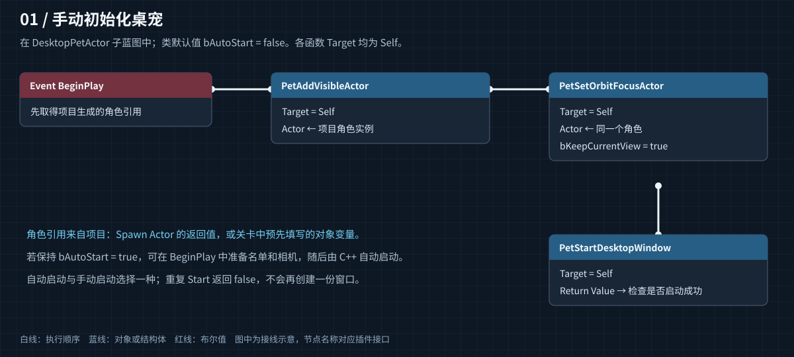
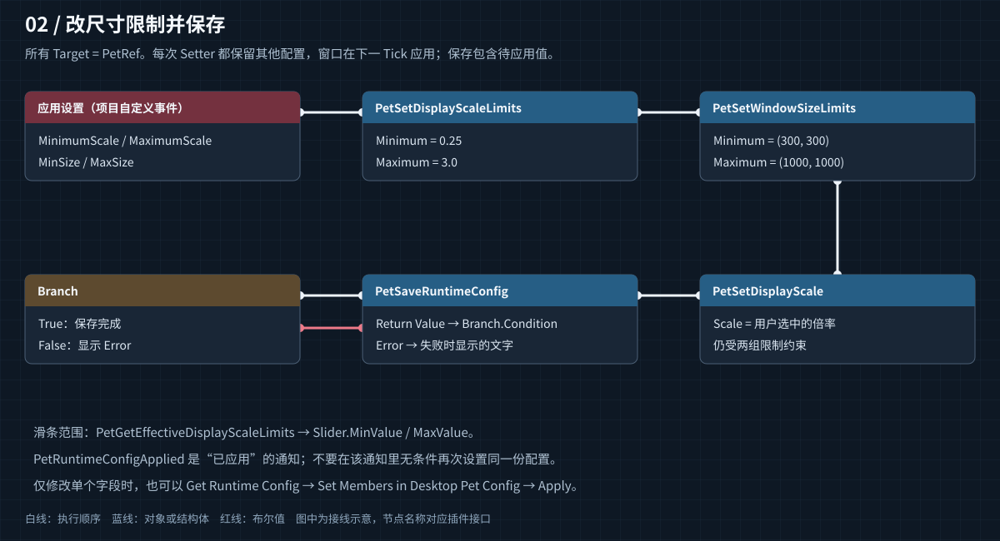
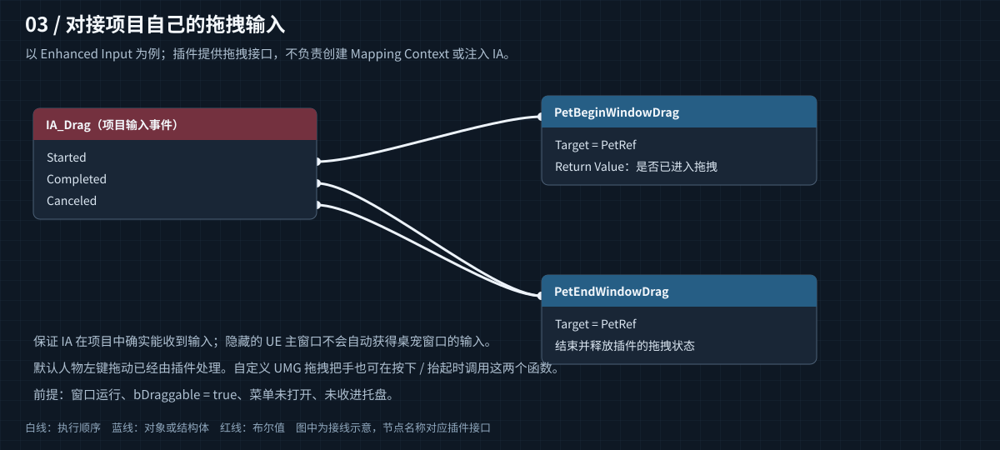
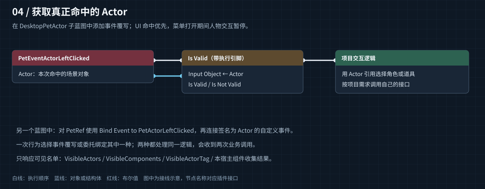
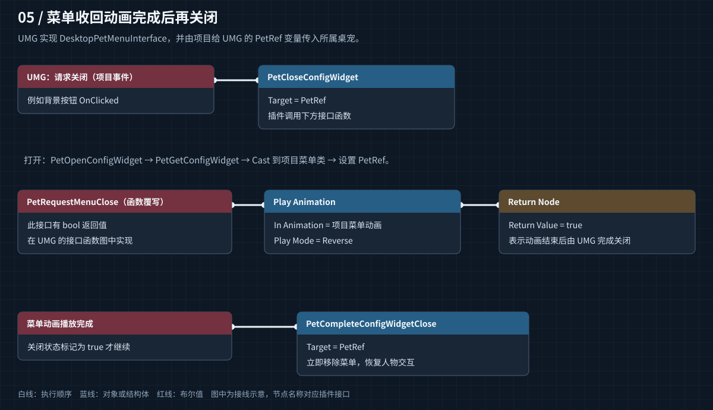
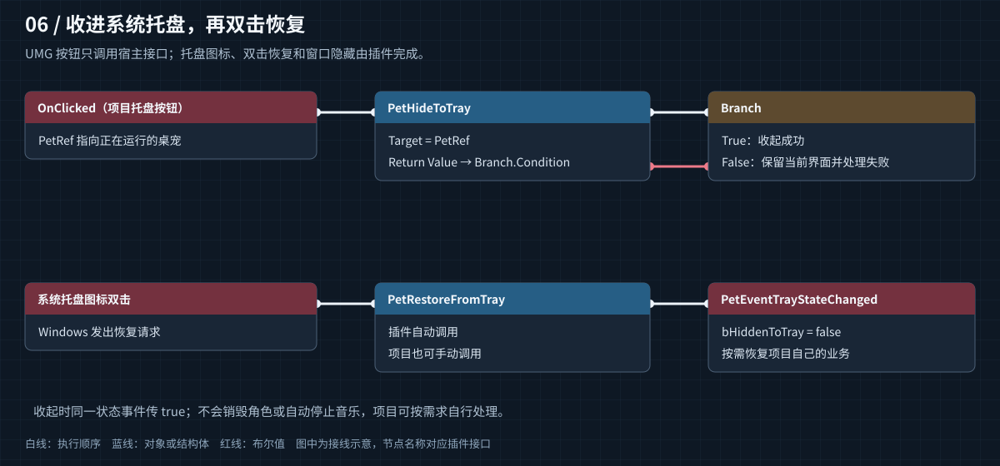
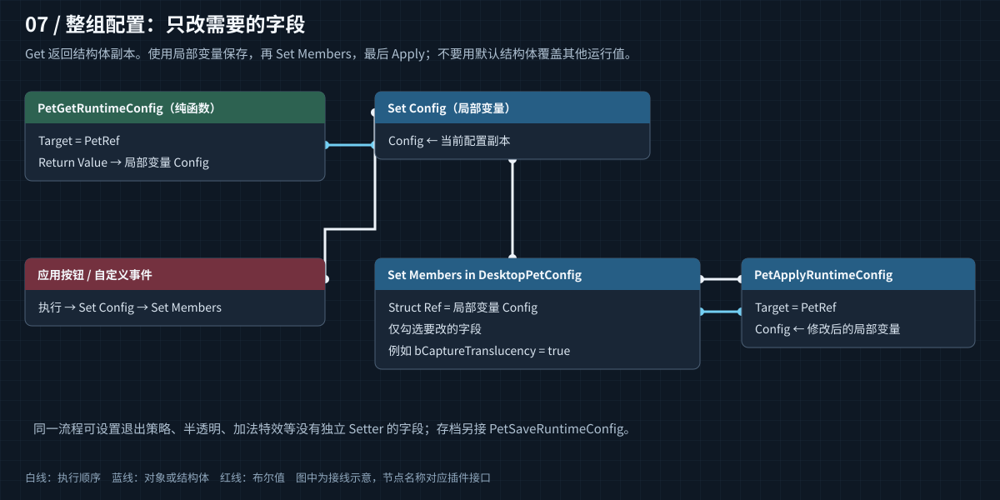

# DesktopPet · Pet Actor 蓝图接口手册

适用于本次整理后的 UE 5.8 / Win64 插件源码。本文中的节点名、参数、默认值和分类来自公开头文件，并按实际实现补充调用时机和限制。

**覆盖范围：171 项 Pet Actor 蓝图成员（含函数、事件和属性）、40 个运行配置字段、9 个指针事件字段、2 个枚举、1 个菜单关闭接口。** 不包含 AActor 自身继承的 UE 通用节点。

文档与 `images/` 一起提交到 GitHub 即可浏览；图为可放大的 SVG，无需安装插件、执行脚本或联网。节点连线是说明图，不能直接粘贴进 UE。

## 目录

- [接入方式与调用约定](#接入方式与调用约定)
- [常用蓝图接线](#常用蓝图接线)
- [全部 Pet Actor 接口](#全部-pet-actor-接口)
- [运行配置字段](#运行配置字段)
- [指针事件与枚举](#指针事件与枚举)
- [菜单关闭接口](#菜单关闭接口)
- [保存与恢复规则](#保存与恢复规则)
- [源码分发与清理生成文件](#源码分发与清理生成文件)
- [代码职责与本次清理](#代码职责与本次清理)

## 接入方式与调用约定

1. 创建以 `DesktopPetActor` 为父类的蓝图并放到关卡中，或者在项目逻辑中生成它。角色、道具、灯光、音乐和 UMG 仍由项目创建。
2. 将角色/道具加入 `VisibleActors`，或通过 `VisibleComponents`、Actor Tag 收集。调用 `PetRefreshVisibleActors` 更新直接编辑后的名单。
3. 在 `Capture` 组件中布置镜头；需要右键环绕时指定 `OrbitFocusActor`。模型不会被转成一张静态图片。
4. 子蓝图中多数节点的 Target 为 `Self`。其他蓝图先保存一个 `DesktopPetActor` 对象引用（本文统一叫 **PetRef**），从此引用拖线搜索节点；UMG 不会自动拥有这个引用，需由项目传入。
5. `bAutoStart` 默认为 true。需要完全控制准备顺序时将它设为 false，再在准备完成后调用 `PetStartDesktopWindow`。

蓝图上下文菜单沿用 `DesktopPet`、`DesktopPet Utility`、`DesktopPetEvent` 分类及其子类。节点可因 UE 显示名规则自动插入空格，下面保留源码标识，便于准确搜索。`Pure` 节点没有白色执行引脚；带返回值的查询函数即使写作 BlueprintCallable，const 查询仍按 UE 规则显示为纯节点。

### 三种尺寸不要混用

| 名称 | 单位与用途 | 主要节点 |
| --- | --- | --- |
| 逻辑画布 `WindowSize` | UMG 布局使用的未缩放尺寸 | `PetSetWindowSize` / `PetGetWindowSize` |
| 显示倍率 `DisplayScale` | 人物与 UI 一起均匀缩放 | `PetSetDisplayScale` / `PetZoomAtScreenPosition` |
| 实际显示尺寸 | 逻辑画布乘倍率后受限、取整的物理像素 | `PetGetDisplaySize` / `PetSetDisplaySize` |
| 窗口位置 `WindowPosition` | 虚拟桌面左上角物理像素 | `PetSetWindowPosition` / `PetGetWindowPosition` |

窗口缩放同时受倍率上下限和物理尺寸上下限约束，冲突时优先满足尺寸限制。比如逻辑画布 600×760，默认物理范围 300×300～1000×1000，有效倍率约为 **0.5～1.316**，而不是简单使用配置中的 0.25～3。极端长宽比可能无法同时等比满足两轴最小值，此时锁定可容纳的倍率，并对最终尺寸逐轴约束。

`PetSetDisplayScale` 是直接设置倍率；滚轮和 `PetZoomAtScreenPosition` 使用鼠标锚点平滑缩放。`bCenterAnchoredScaling` 只决定直接修改尺寸时是否保持中心，不改变滚轮锚点规则。

### 配置的生效时机

配置类 Setter 最终走 `PetApplyRuntimeConfig`，先缓存并规范化，随后在 Tick 安全边界更新窗口/渲染资源；不会在 UMG 按钮回调中立即销毁绘制资源。可以在同一条执行链上设置多个值；调用完成后通过 `PetRuntimeConfigApplied` 获得已应用通知。保存节点包含待应用值，不需要为了保存额外 Delay。

本规则不意味着所有函数都延迟：名单刷新、相机设置、托盘操作等各自按下面说明执行。对 None 引用调用节点无效；项目取得 Actor、Widget 等对象引用后应按需要接 `Is Valid`。

## 常用蓝图接线

### 初始化显示



先准备名单与镜头，再 Start。自动启动已开启时，可以只做准备，让父类在蓝图 BeginPlay 返回后启动；不要把“已运行时 Start 返回 false”误判成窗口丢失。

### 主动获取窗口焦点

在 Pet Actor 蓝图中连接：`Event BeginPlay → PetStartDesktopWindow → PetRequestFocus → Branch(Return Value)`。两个节点的 Target 都是当前 Pet Actor。

`bAutoStart` 的自动创建发生在蓝图 BeginPlay 返回之后，因此不要只在 BeginPlay 直接请求焦点：先显式 Start，或者等待自动启动完成后再调用。已有窗口时 Start 返回 false，但仍可调用 Request Focus；不要仅用 Start 的返回值截断执行链。

从托盘恢复时连接 `PetRestoreFromTray → PetRequestFocus`。默认启动、自动托盘恢复、拖拽和穿透行为保持原样；没有连接新节点就不会主动抢焦点。无需每 Tick 调用，也不要持续重试抢回用户已切走的焦点。

这是原生 HWND 的前台与键盘焦点入口。当前插件的离屏 UMG 和项目 Enhanced Input 不会因此自动收到键盘/字符事件；该接口不更改输入路由，也不替输入框选择焦点。

### 设置范围并保存



默认物理窗口最小 300×300、最大 1000×1000。设置面板的倍率滑条应读取 `PetGetEffectiveDisplayScaleLimits`。保存失败时显示 `Error`，不要把返回执行引脚等同于保存成功。

### 接入拖拽输入



插件已处理人物左键拖动；图中适用于项目自己提供的输入入口。Enhanced Input 必须在项目中完成绑定并实际收到事件。隐藏的 UE 游戏窗口不会自动收到透明桌宠窗口的输入，插件也不再注入 IA；需要时可用 UMG 按下/抬起事件或 `PetPointerInput` 接自己的输入层。

### 人物与道具事件



点击定义为**按下**。拾取以最终场景 Alpha 和可见组件包围盒联合判断，不要求项目配置 Physics Asset；它不是三角形级射线拾取。装饰 UI 与交互 UI 的命中优先级由插件的 Slate 命中路径处理。

### 打开菜单与关闭动画



菜单类填写在 `ConfigWidgetClass`。打开后通过 `PetGetConfigWidget` 取得实例，再 Cast 到项目自己的菜单类，为 `PetRef` 赋值。构造事件发生在赋值前，因此不要在 Construct 中假设 PetRef 已有效。

在 UMG 的 Class Settings 添加 `DesktopPetMenuInterface`。`PetRequestMenuClose` **有 bool 返回值，是接口函数覆写**；在函数中启动反向播放并立刻返回 true，不放 Delay 等潜伏节点。在动画完成事件中检查项目的 `bClosing` 状态，确认是收回过程后调用 `PetCompleteConfigWidgetClose`。返回 false 或不实现接口则立即关闭。

菜单实例可能复用；不要只依赖 Construct 播每次打开动画。可由宿主在 Open 成功后调用项目菜单的 Open 动画函数，或在项目中处理菜单可见性通知。停止窗口、收进托盘、替换菜单类会立即完成关闭。

### 系统托盘



没有可恢复的托盘入口就不会隐藏桌宠。双击图标由插件自动恢复；不需要用定时器检测双击。收进托盘后捕获停止，项目业务 Tick 仍按后台帧率运行；音乐是否暂停由项目自行决定。

### 修改没有单独 Setter 的字段



例如 `bCaptureTranslucency`、`bPreserveAdditiveEffects`、`AdditiveAlphaStrength`、`bExitApplicationOnClose`：读取当前配置到局部变量，在 `Set Members in Desktop Pet Config` 中只暴露需要修改的成员，再 Apply。不要每次从默认 Make 节点开始，否则可能覆盖用户已经修改的尺寸、位置或音量。

## 全部 Pet Actor 接口

以下包括**全部公开给蓝图的本类成员**。参数类型使用 C++ 原名：`FIntPoint` 为两个整数，`FVector2D` 为二维向量，`FName` 为 Name，`TSubclassOf` 为类引用，`TObjectPtr` 为对象引用。`const &` 输入不会要求蓝图传 C++ 引用；非 const `&` 参数列为输出引脚。


### 分类索引

- **DesktopPet / Capture**（9 项）：[Capture](#capture)、[VisibleActors](#visibleactors)、[VisibleComponents](#visiblecomponents)、[VisibleActorTag](#visibleactortag)、[bIncludeOwnComponents](#bincludeowncomponents)、[PetAddVisibleActor](#petaddvisibleactor)、[PetAddVisibleComponent](#petaddvisiblecomponent)、[PetRefreshVisibleActors](#petrefreshvisibleactors)、[PetRemoveVisibleActor](#petremovevisibleactor)。
- **DesktopPet / Lifecycle**（5 项）：[bAutoStart](#bautostart)、[PetRequestClose](#petrequestclose)、[PetRestartDesktopWindow](#petrestartdesktopwindow)、[PetStartDesktopWindow](#petstartdesktopwindow)、[PetStopDesktopWindow](#petstopdesktopwindow)。
- **DesktopPet / Configuration**（3 项）：[bOverrideDefaultConfig](#boverridedefaultconfig)、[InitialConfig](#initialconfig)、[PetApplyRuntimeConfig](#petapplyruntimeconfig)。
- **DesktopPet / Persistence**（6 项）：[SavedConfigProfile](#savedconfigprofile)、[bAutoLoadSavedConfig](#bautoloadsavedconfig)、[PetDeleteSavedRuntimeConfig](#petdeletesavedruntimeconfig)、[PetHasSavedRuntimeConfig](#pethassavedruntimeconfig)、[PetLoadRuntimeConfig](#petloadruntimeconfig)、[PetSaveRuntimeConfig](#petsaveruntimeconfig)。
- **DesktopPetEvent**（20 项）：[PetActorMouseEnter](#petactormouseenter)、[PetActorMouseLeave](#petactormouseleave)、[PetActorLeftClicked](#petactorleftclicked)、[PetActorRightClicked](#petactorrightclicked)、[PetHoverChanged](#pethoverchanged)、[PetAction](#petaction)、[PetClicked](#petclicked)、[PetPointerInput](#petpointerinput)、[PetInteractionProgress](#petinteractionprogress)、[PetDragStateChanged](#petdragstatechanged)、[PetRuntimeConfigApplied](#petruntimeconfigapplied)、[PetTrayStateChanged](#pettraystatechanged)、[PetActorMouseHover](#petactormousehover)、[PetConfigWidgetVisibilityChanged](#petconfigwidgetvisibilitychanged)、[PetEventActorLeftClicked](#peteventactorleftclicked)、[PetEventActorMouseEnter](#peteventactormouseenter)、[PetEventActorMouseHover](#peteventactormousehover)、[PetEventActorMouseLeave](#peteventactormouseleave)、[PetEventActorRightClicked](#peteventactorrightclicked)、[PetEventTrayStateChanged](#peteventtraystatechanged)。
- **DesktopPet / UI**（8 项）：[WidgetOverride](#widgetoverride)、[ConfigWidgetClass](#configwidgetclass)、[PetCloseConfigWidget](#petcloseconfigwidget)、[PetCompleteConfigWidgetClose](#petcompleteconfigwidgetclose)、[PetSetConfigWidgetClass](#petsetconfigwidgetclass)、[PetSetInteractionTiming](#petsetinteractiontiming)、[PetOpenConfigWidget](#petopenconfigwidget)、[PetSetOverlayWidget](#petsetoverlaywidget)。
- **DesktopPet / Orbit**（10 项）：[OrbitFocusActor](#orbitfocusactor)、[OrbitCenterOffset](#orbitcenteroffset)、[OrbitDistance](#orbitdistance)、[OrbitRotation](#orbitrotation)、[OrbitSensitivity](#orbitsensitivity)、[PetFrameActor](#petframeactor)、[PetSetOrbitFocusActor](#petsetorbitfocusactor)、[PetSetOrbitRotation](#petsetorbitrotation)、[PetSetOrbitSettings](#petsetorbitsettings)、[PetResetView](#petresetview)。
- **DesktopPet Utility / Lifecycle**（1 项）：[PetIsDesktopWindowRunning](#petisdesktopwindowrunning)。
- **DesktopPet Utility / Persistence**（1 项）：[PetGetSavedConfigPath](#petgetsavedconfigpath)。
- **DesktopPet Utility / Configuration**（18 项）：[PetGetAdditiveAlphaStrength](#petgetadditivealphastrength)、[PetGetAlwaysOnTop](#petgetalwaysontop)、[PetGetCaptureTranslucency](#petgetcapturetranslucency)、[PetGetClickThroughTransparentPixels](#petgetclickthroughtransparentpixels)、[PetGetDefaultRuntimeConfig](#petgetdefaultruntimeconfig)、[PetGetDisplayScale](#petgetdisplayscale)、[PetGetDraggable](#petgetdraggable)、[PetGetExitApplicationOnClose](#petgetexitapplicationonclose)、[PetGetExposure](#petgetexposure)、[PetGetHideGameWindow](#petgethidegamewindow)、[PetGetHitAlphaThreshold](#petgethitalphathreshold)、[PetGetMenuAnimationSeconds](#petgetmenuanimationseconds)、[PetGetMenuCloseDelay](#petgetmenuclosedelay)、[PetGetPreserveAdditiveEffects](#petgetpreserveadditiveeffects)、[PetGetRuntimeConfig](#petgetruntimeconfig)、[PetGetSupersampleScale](#petgetsupersamplescale)、[PetGetTargetFrameRate](#petgettargetframerate)、[PetGetWindowSize](#petgetwindowsize)。
- **DesktopPet / Window**（12 项）：[PetRequestFocus](#petrequestfocus)、[PetSetAllowScreenCapture](#petsetallowscreencapture)、[PetSetAlwaysOnTop](#petsetalwaysontop)、[PetSetCenterAnchoredScaling](#petsetcenteranchoredscaling)、[PetSetDisplayScale](#petsetdisplayscale)、[PetSetDisplaySize](#petsetdisplaysize)、[PetSetHideGameWindow](#petsethidegamewindow)、[PetSetShowInTaskbar](#petsetshowintaskbar)、[PetSetTransparentWindowEnabled](#petsettransparentwindowenabled)、[PetSetWindowMode](#petsetwindowmode)、[PetSetWindowPosition](#petsetwindowposition)、[PetSetWindowSize](#petsetwindowsize)。
- **DesktopPet Utility / Window**（8 项）：[PetHasFocus](#pethasfocus)、[PetGetAllowScreenCapture](#petgetallowscreencapture)、[PetGetCenterAnchoredScaling](#petgetcenteranchoredscaling)、[PetGetDisplaySize](#petgetdisplaysize)、[PetGetShowInTaskbar](#petgetshowintaskbar)、[PetGetTransparentWindowEnabled](#petgettransparentwindowenabled)、[PetGetWindowMode](#petgetwindowmode)、[PetGetWindowPosition](#petgetwindowposition)。
- **DesktopPet / Window / Limits**（6 项）：[PetSetDisplayScaleLimits](#petsetdisplayscalelimits)、[PetSetMaxDisplayScale](#petsetmaxdisplayscale)、[PetSetMaxWindowSize](#petsetmaxwindowsize)、[PetSetMinDisplayScale](#petsetmindisplayscale)、[PetSetMinWindowSize](#petsetminwindowsize)、[PetSetWindowSizeLimits](#petsetwindowsizelimits)。
- **DesktopPet Utility / Window / Limits**（5 项）：[PetGetEffectiveDisplayScaleLimits](#petgeteffectivedisplayscalelimits)、[PetGetMaxDisplayScale](#petgetmaxdisplayscale)、[PetGetMaxWindowSize](#petgetmaxwindowsize)、[PetGetMinDisplayScale](#petgetmindisplayscale)、[PetGetMinWindowSize](#petgetminwindowsize)。
- **DesktopPet / Input**（9 项）：[PetBeginWindowDrag](#petbeginwindowdrag)、[PetSetClickThroughTransparentPixels](#petsetclickthroughtransparentpixels)、[PetSetDraggable](#petsetdraggable)、[PetEndWindowDrag](#petendwindowdrag)、[PetSetHitAlphaThreshold](#petsethitalphathreshold)、[PetSetWheelZoomEnabled](#petsetwheelzoomenabled)、[PetSetWheelZoomStep](#petsetwheelzoomstep)、[PetSetZoomAnimationSeconds](#petsetzoomanimationseconds)、[PetZoomAtScreenPosition](#petzoomatscreenposition)。
- **DesktopPet Utility / Input**（6 项）：[PetGetWheelZoomEnabled](#petgetwheelzoomenabled)、[PetGetWheelZoomStep](#petgetwheelzoomstep)、[PetIsWindowDragging](#petiswindowdragging)、[PetGetZoomAnimationSeconds](#petgetzoomanimationseconds)、[PetGetZoomTargetScale](#petgetzoomtargetscale)、[PetIsZooming](#petiszooming)。
- **DesktopPet / Interaction**（1 项）：[PetMouseScreenVectorOrigin](#petmousescreenvectororigin)。
- **DesktopPet Utility / Interaction**（6 项）：[PetGetActorToMouseScreenVector](#petgetactortomousescreenvector)、[PetGetMouseWorldPositionOnPlane](#petgetmouseworldpositiononplane)、[PetGetActorToMouseScreenDistanceRatio](#petgetactortomousescreendistanceratio)、[PetGetHoveredActor](#petgethoveredactor)、[PetGetInteractionActorAtPixel](#petgetinteractionactoratpixel)、[PetGetInteractionActors](#petgetinteractionactors)。
- **DesktopPet Utility / UI**（4 项）：[PetGetConfigWidget](#petgetconfigwidget)、[PetIsConfigWidgetOpen](#petisconfigwidgetopen)、[PetGetInteractionProgress](#petgetinteractionprogress)、[PetGetOverlayWidget](#petgetoverlaywidget)。
- **DesktopPet Utility / Orbit**（3 项）：[PetGetOrbitCenter](#petgetorbitcenter)、[PetGetOrbitDistance](#petgetorbitdistance)、[PetGetOrbitFocusActor](#petgetorbitfocusactor)。
- **DesktopPet Utility / Tray**（1 项）：[PetIsHiddenToTray](#petishiddentotray)。
- **DesktopPet / Tray**（2 项）：[PetHideToTray](#pethidetotray)、[PetRestoreFromTray](#petrestorefromtray)。
- **DesktopPet / Audio**（2 项）：[PetSetBackgroundAudioEnabled](#petsetbackgroundaudioenabled)、[PetSetBackgroundVolumeMultiplier](#petsetbackgroundvolumemultiplier)。
- **DesktopPet Utility / Audio**（2 项）：[PetGetBackgroundAudioEnabled](#petgetbackgroundaudioenabled)、[PetGetBackgroundVolumeMultiplier](#petgetbackgroundvolumemultiplier)。
- **DesktopPet Utility / Performance**（4 项）：[PetGetEffectiveEngineFrameRateLimit](#petgeteffectiveengineframeratelimit)、[PetGetGPUCompositingEnabled](#petgetgpucompositingenabled)、[PetGetLimitEngineFrameRate](#petgetlimitengineframerate)、[PetGetTrayFrameRate](#petgettrayframerate)。
- **DesktopPet / Performance**（3 项）：[PetSetGPUCompositingEnabled](#petsetgpucompositingenabled)、[PetSetLimitEngineFrameRate](#petsetlimitengineframerate)、[PetSetTrayFrameRate](#petsettrayframerate)。
- **DesktopPet / Memory**（2 项）：[PetSetCompactMemory](#petsetcompactmemory)、[PetSetMemoryCapacities](#petsetmemorycapacities)。
- **DesktopPet Utility / Memory**（6 项）：[PetGetCompactMemory](#petgetcompactmemory)、[PetIsCompactMemoryActive](#petiscompactmemoryactive)、[PetGetIdleRenderTargetPoolMB](#petgetidlerendertargetpoolmb)、[PetGetRadianceProbeCapacity](#petgetradianceprobecapacity)、[PetGetShadowPageCapacity](#petgetshadowpagecapacity)、[PetGetSurfaceCacheCapacity](#petgetsurfacecachecapacity)。
- **DesktopPet / Quality**（4 项）：[PetSetExposure](#petsetexposure)、[PetSetSharpness](#petsetsharpness)、[PetSetSupersampleScale](#petsetsupersamplescale)、[PetSetTargetFrameRate](#petsettargetframerate)。
- **DesktopPet Utility / Quality**（1 项）：[PetGetSharpness](#petgetsharpness)。
- **DesktopPet / Cursor**（1 项）：[PetSetCompositeSoftwareCursorEnabled](#petsetcompositesoftwarecursorenabled)。
- **DesktopPet Utility / Cursor**（1 项）：[PetGetCompositeSoftwareCursorEnabled](#petgetcompositesoftwarecursorenabled)。
- **DesktopPet / Events**（1 项）：[PetDispatchAction](#petdispatchaction)。

## DesktopPet / Capture

### Capture

**只读属性** · `DesktopPet / Capture`

项目自行设置相机位置、投影和视角；模型始终留在项目场景中。

```cpp
TObjectPtr<USceneCaptureComponent2D> Capture;
```

**引脚 / 类型：** 类型：`TObjectPtr<USceneCaptureComponent2D>`；默认：`类型默认值`。

**使用：** 在组件面板设置变换、FOV、投影和所需后处理。插件管理它的输出纹理与捕获时机；不要再打开每帧自动捕获。存在 OrbitFocusActor 时，环绕逻辑会更新其变换。

### VisibleActors

**可读写属性** · `DesktopPet / Capture`

要显示的 Actor，包括角色、道具及含 NiagaraComponent 的特效 Actor。

```cpp
TArray<TObjectPtr<AActor>> VisibleActors;
```

**引脚 / 类型：** 类型：`TArray<TObjectPtr<AActor>>`；默认：`类型默认值`。

**使用：** 关卡实例中填写对象引用；直接改数组后调用 PetRefreshVisibleActors。运行时增删优先用 PetAddVisibleActor / PetRemoveVisibleActor。

### VisibleComponents

**可读写属性** · `DesktopPet / Capture`

组件级白名单，方便只显示一个 Actor 的部分模型或某个 NiagaraComponent。

```cpp
TArray<TObjectPtr<UPrimitiveComponent>> VisibleComponents;
```

**引脚 / 类型：** 类型：`TArray<TObjectPtr<UPrimitiveComponent>>`；默认：`类型默认值`。

**使用：** 填写实际组件引用，直接改数组后刷新名单。没有独立移除组件节点，可从数组中移除后刷新。

### VisibleActorTag

**可读写属性** · `DesktopPet / Capture`

具有该 Actor Tag 的对象也会进入白名单；None 表示不按标签收集。

```cpp
FName VisibleActorTag = TEXT("DesktopPetVisible");
```

**引脚 / 类型：** 类型：`FName`；默认：`TEXT("DesktopPetVisible")`。

**使用：** 使用 Actor 的 Tags（不是 Component Tags）；修改标签或动态创建带标签对象后调用 PetRefreshVisibleActors。

### bIncludeOwnComponents

**可读写属性** · `DesktopPet / Capture`

是否显示本宿主的 PrimitiveComponent；通用宿主默认没有模型。

```cpp
bool bIncludeOwnComponents = false;
```

**引脚 / 类型：** 类型：`bool`；默认：`false`。

**使用：** 类默认值中启用可收集宿主自身的可渲染组件；运行时修改后刷新名单。

### PetAddVisibleActor

**执行函数** · `DesktopPet / Capture`

添加一个运行时对象并立即刷新捕获白名单。

```cpp
void PetAddVisibleActor(AActor* Actor);
```

**引脚 / 类型：** Target：DesktopPetActor 对象引用；输入 `Actor`：`AActor*`。

**使用：** 连接项目生成或关卡已有的 Actor 引用，随后立即刷新。只改变捕获名单，不创建角色，不修改材质或灯光。

### PetAddVisibleComponent

**执行函数** · `DesktopPet / Capture`

添加单个渲染组件，例如 NiagaraComponent。

```cpp
void PetAddVisibleComponent(UPrimitiveComponent* Component);
```

**引脚 / 类型：** Target：DesktopPetActor 对象引用；输入 `Component`：`UPrimitiveComponent*`。

**使用：** 传入有效 PrimitiveComponent，可用于一个 Actor 的局部网格或 NiagaraComponent。随后立即刷新名单。

### PetRefreshVisibleActors

**执行函数** · `DesktopPet / Capture`

重新收集 Actor/组件/标签白名单，支持运行时生成的 Niagara。

```cpp
void PetRefreshVisibleActors();
```

**引脚 / 类型：** Target：DesktopPetActor 对象引用。

**使用：** 在直接编辑名单/标签，或运行时新增组件后调用。不必每 Tick 重复收集。

### PetRemoveVisibleActor

**执行函数** · `DesktopPet / Capture`

移除白名单中的 Actor 并刷新。

```cpp
void PetRemoveVisibleActor(AActor* Actor);
```

**引脚 / 类型：** Target：DesktopPetActor 对象引用；输入 `Actor`：`AActor*`。

**使用：** 从显式 VisibleActors 中移除；若对象仍通过标签、VisibleComponents 或自身组件规则被收集，它仍会显示和参与交互。


## DesktopPet / Lifecycle

### bAutoStart

**可读写属性** · `DesktopPet / Lifecycle`

BeginPlay 是否自动创建桌宠原生窗口。

```cpp
bool bAutoStart = true;
```

**引脚 / 类型：** 类型：`bool`；默认：`true`。

**使用：** 在类默认值或生成 Actor 之前配置。BeginPlay 中的蓝图逻辑执行后，C++ 才执行自动启动；若自行调用 Start，建议关闭自动启动。

### PetRequestClose

**执行函数** · `DesktopPet / Lifecycle`

请求关闭桌宠，是否退出游戏由 bExitApplicationOnClose 决定。

```cpp
void PetRequestClose();
```

**引脚 / 类型：** Target：DesktopPetActor 对象引用。

**使用：** 窗口存在时安排下一 Tick 关闭。bExitApplicationOnClose 控制是否退出独立游戏；PIE 不退出编辑器。没有窗口时不执行。

### PetRestartDesktopWindow

**执行函数** · `DesktopPet / Lifecycle`

请求下一 Tick 重新创建；普通运行时修改无需调用此函数。

```cpp
void PetRestartDesktopWindow();
```

**引脚 / 类型：** Target：DesktopPetActor 对象引用。

**使用：** 仅安排下一 Tick 停止再启动；更改普通配置不需要重启。启动时的相机恢复基准会重新记录。

### PetStartDesktopWindow

**执行函数** · `DesktopPet / Lifecycle`

创建通用窗口及捕获资源；允许没有 Widget 或没有人物。

```cpp
bool PetStartDesktopWindow();
```

**引脚 / 类型：** Target：DesktopPetActor 对象引用；输出 `Return Value`：`bool`。

**使用：** 返回 true 表示资源与窗口创建成功；已运行、命令行工具环境或 Slate 未初始化时返回 false。空名单也允许启动，但看不到模型。

### PetStopDesktopWindow

**执行函数** · `DesktopPet / Lifecycle`

停止透明显示；不会自动恢复被要求隐藏的 UE 窗口。

```cpp
void PetStopDesktopWindow();
```

**引脚 / 类型：** Target：DesktopPetActor 对象引用。

**使用：** 释放捕获与窗口资源，关闭菜单；不会销毁场景角色或自动退出进程。此前被隐藏的主窗口不会因此自动显示。


## DesktopPet / Configuration

### bOverrideDefaultConfig

**可读写属性** · `DesktopPet / Configuration`

选中后使用本 Actor 的 InitialConfig，否则使用项目 ini 默认值。

```cpp
bool bOverrideDefaultConfig = false;
```

**引脚 / 类型：** 类型：`bool`；默认：`false`。

**使用：** 决定没有已加载/已应用配置时的初始来源。运行中改这个属性不会替换当前配置；使用 PetApplyRuntimeConfig。

### InitialConfig

**可读写属性** · `DesktopPet / Configuration`

可在关卡实例或蓝图默认值上填写的起始配置。

```cpp
FDesktopPetConfig InitialConfig;
```

**引脚 / 类型：** 类型：`FDesktopPetConfig`；默认：`类型默认值`。

**使用：** 需要 bOverrideDefaultConfig = true。运行时修改此属性本身不会应用到当前窗口。

### PetApplyRuntimeConfig

**执行函数** · `DesktopPet / Configuration`

整组应用所有参数；合并到下一 Tick，避免在 UMG 回调内销毁绘制资源。

```cpp
void PetApplyRuntimeConfig(const FDesktopPetConfig& Config);
```

**引脚 / 类型：** Target：DesktopPetActor 对象引用；输入 `Config`：`const FDesktopPetConfig&`。

**使用：** 推荐先 Get 当前配置，再 Set Members，最后 Apply。参数规范化并合并到下一 Tick；配置事件在实际应用后发出。未启动时先缓存供 Start 使用。


## DesktopPet / Persistence

### SavedConfigProfile

**可读写属性** · `DesktopPet / Persistence`

启动时读取此档案；多桌宠使用不同档名。仅允许 1～64 个英文字母、数字、下划线或连字符。修改档名不会立即加载。

```cpp
FString SavedConfigProfile = TEXT("Default");
```

**引脚 / 类型：** 类型：`FString`；默认：`TEXT("Default")`。

**使用：** 例如 MainPet。多个实例应使用不同档名。改名后需要显式 Load / Save；不自动迁移旧文件。

### bAutoLoadSavedConfig

**可读写属性** · `DesktopPet / Persistence`

在蓝图 BeginPlay 之前自动读取已有存档，优先于 InitialConfig/项目默认值；显式运行时设置仍可覆盖。只读取，不会自动保存。

```cpp
bool bAutoLoadSavedConfig = true;
```

**引脚 / 类型：** 类型：`bool`；默认：`true`。

**使用：** 加载发生在蓝图 BeginPlay 之前；此开关应在类默认值或实例初始值中设定。没有文件时保持初始配置。

### PetDeleteSavedRuntimeConfig

**执行函数** · `DesktopPet / Persistence`

删除本档案；不会改变当前窗口，也不会自动保存。下次启动无存档时使用初始配置。

```cpp
bool PetDeleteSavedRuntimeConfig(FString& Error);
```

**引脚 / 类型：** Target：DesktopPetActor 对象引用；输出 `Error`：`FString&`；输出 `Return Value`：`bool`。

**使用：** 仅删除 SavedConfigProfile 对应的配置文件；不会重置当前显示。请不要在每 Tick 中调用。

### PetHasSavedRuntimeConfig

**纯函数** · `DesktopPet / Persistence`

查询配置文件是否存在；存在不代表内容有效，读取结果以 PetLoadRuntimeConfig 为准。

```cpp
bool PetHasSavedRuntimeConfig() const;
```

**引脚 / 类型：** Target：DesktopPetActor 对象引用；输出 `Return Value`：`bool`。

**使用：** 纯查询文件是否存在；损坏文件也可能返回 true，仍需检查 Load 的返回值。

### PetLoadRuntimeConfig

**执行函数** · `DesktopPet / Persistence`

读取并应用配置档；失败保留当前配置，成功后窗口下一 Tick 更新，保存的位置按原值恢复。

```cpp
bool PetLoadRuntimeConfig(FString& Error);
```

**引脚 / 类型：** Target：DesktopPetActor 对象引用；输出 `Error`：`FString&`；输出 `Return Value`：`bool`。

**使用：** 成功提交整组配置，运行中的窗口下一 Tick 更新；失败不替换当前值。恢复存档的位置不会再次执行中心锚定偏移。

### PetSaveRuntimeConfig

**执行函数** · `DesktopPet / Persistence`

将当前通用运行参数保存到配置档；包含待应用的 Setter 修改和已显示的滚轮缩放。成功返回 true，失败给出原因。

```cpp
bool PetSaveRuntimeConfig(FString& Error);
```

**引脚 / 类型：** Target：DesktopPetActor 对象引用；输出 `Error`：`FString&`；输出 `Return Value`：`bool`。

**使用：** 在用户点“保存”时调用并检查 Return Value；失败读取 Error。保存 40 个配置字段，不保存角色引用、菜单类、环绕姿态或业务数据。


## DesktopPetEvent

### PetActorMouseEnter

**事件委托** · `DesktopPetEvent`

指针进入白名单 Actor 时触发一次，并给出该 Actor。

```cpp
FDesktopPetActorEvent PetActorMouseEnter;
```

**引脚 / 类型：** Actor · Actor 对象引用

**使用：** 在持有 PetRef 的蓝图中使用 Bind Event to PetActorMouseEnter 或 Assign；事件签名需匹配下方数据引脚。生命周期结束时按项目需要解绑。

### PetActorMouseLeave

**事件委托** · `DesktopPetEvent`

指针移出、进入 UI、移除白名单、停止显示或销毁对象时触发离开。

```cpp
FDesktopPetActorEvent PetActorMouseLeave;
```

**引脚 / 类型：** Actor · Actor 对象引用

**使用：** 在持有 PetRef 的蓝图中使用 Bind Event to PetActorMouseLeave 或 Assign；事件签名需匹配下方数据引脚。生命周期结束时按项目需要解绑。

### PetActorLeftClicked

**事件委托** · `DesktopPetEvent`

左键按下命中白名单 Actor 时触发；UI 优先，不以窗口整体代替 Actor。

```cpp
FDesktopPetActorEvent PetActorLeftClicked;
```

**引脚 / 类型：** Actor · Actor 对象引用

**使用：** 在持有 PetRef 的蓝图中使用 Bind Event to PetActorLeftClicked 或 Assign；事件签名需匹配下方数据引脚。生命周期结束时按项目需要解绑。

### PetActorRightClicked

**事件委托** · `DesktopPetEvent`

右键按下命中白名单 Actor 时触发。

```cpp
FDesktopPetActorEvent PetActorRightClicked;
```

**引脚 / 类型：** Actor · Actor 对象引用

**使用：** 在持有 PetRef 的蓝图中使用 Bind Event to PetActorRightClicked 或 Assign；事件签名需匹配下方数据引脚。生命周期结束时按项目需要解绑。

### PetHoverChanged

**事件委托** · `DesktopPetEvent`

兼容旧接口：是否悬停在白名单 Actor 上；需要对象引用请使用 Actor Events。

```cpp
FDesktopPetHover PetHoverChanged;
```

**引脚 / 类型：** bHovered · Boolean（菜单可见性委托中表示是否打开）

**使用：** 在持有 PetRef 的蓝图中使用 Bind Event to PetHoverChanged 或 Assign；事件签名需匹配下方数据引脚。生命周期结束时按项目需要解绑。

### PetAction

**事件委托** · `DesktopPetEvent`

通用用户动作总线；插件不解释 Chat、Quit 等项目业务名称。

```cpp
FDesktopPetAction PetAction;
```

**引脚 / 类型：** Action · Name

**使用：** 用 Bind Event / Assign 接收 PetDispatchAction 的 Action；项目自己解释名称。

### PetClicked

**事件委托** · `DesktopPetEvent`

兼容旧接口：白名单 Actor 的左键通知；新接口同时返回 Actor 引用。

```cpp
FDesktopPetClick PetClicked;
```

**引脚 / 类型：** 无数据引脚

**使用：** 在持有 PetRef 的蓝图中使用 Bind Event to PetClicked 或 Assign；事件签名需匹配下方数据引脚。生命周期结束时按项目需要解绑。

### PetPointerInput

**事件委托** · `DesktopPetEvent`

原始指针事件，项目可以桥接到自己的输入或交互系统。

```cpp
FDesktopPetPointer PetPointerInput;
```

**引脚 / 类型：** Event · DesktopPetPointerEvent 结构体

**使用：** 绑定后获得原始指针结构体；项目自行决定是否消费或映射给输入系统。bOverScene 不是有效 Actor 引用的保证，仍要检查 HitActor。

### PetInteractionProgress

**事件委托** · `DesktopPetEvent`

0–1 的交互展开进度；具体菜单排布、动画和可见性完全由项目控制。

```cpp
FDesktopPetInteraction PetInteractionProgress;
```

**引脚 / 类型：** Progress · Float（0～1）；CanvasSize · Vector2D（逻辑画布）

**使用：** Progress 0～1；CanvasSize 是 WindowSize 逻辑尺寸。该进度不是 ConfigWidget 动画的自动播放控制器。

### PetDragStateChanged

**事件委托** · `DesktopPetEvent`

原生窗口拖拽的开始/结束通知。

```cpp
FDesktopPetDrag PetDragStateChanged;
```

**引脚 / 类型：** bDragging · Boolean

**使用：** 在持有 PetRef 的蓝图中使用 Bind Event to PetDragStateChanged 或 Assign；事件签名需匹配下方数据引脚。生命周期结束时按项目需要解绑。

### PetRuntimeConfigApplied

**事件委托** · `DesktopPetEvent`

配置已经应用到窗口及渲染目标后发出，不在 Setter 调用中提前广播。

```cpp
FDesktopPetConfigChanged PetRuntimeConfigApplied;
```

**引脚 / 类型：** Config · DesktopPetConfig 结构体

**使用：** 在 Start 完成或下一 Tick 应用成功后广播。回调内可以读尺寸刷新设置面板；避免无条件 Apply 造成每 Tick 循环。

### PetTrayStateChanged

**事件委托** · `DesktopPetEvent`

托盘状态变化：true 为收起，false 为恢复。项目可以据此暂停自己的音频等业务。

```cpp
FDesktopPetTray PetTrayStateChanged;
```

**引脚 / 类型：** bHiddenToTray · Boolean

**使用：** 在持有 PetRef 的蓝图中使用 Bind Event to PetTrayStateChanged 或 Assign；事件签名需匹配下方数据引脚。生命周期结束时按项目需要解绑。

### PetActorMouseHover

**事件委托** · `DesktopPetEvent`

持续悬停时每帧触发，参数为可见名单中的实际 Actor。菜单开启期间暂停。

```cpp
FDesktopPetActorEvent PetActorMouseHover;
```

**引脚 / 类型：** Actor · Actor 对象引用

**使用：** 持续通知，不适合在每次回调中加载资产、创建菜单或写文件。只想开始时触发一次请用 MouseEnter。

### PetConfigWidgetVisibilityChanged

**事件委托** · `DesktopPetEvent`

双击菜单显示状态变化；与角色/菜单业务解耦。

```cpp
FDesktopPetHover PetConfigWidgetVisibilityChanged;
```

**引脚 / 类型：** bHovered · Boolean（菜单可见性委托中表示是否打开）

**使用：** 虽然复用 FDesktopPetHover 的 bHovered 引脚名，这里 true 表示菜单打开、false 表示已完成关闭。

### PetEventActorLeftClicked

**事件覆写** · `DesktopPetEvent`

左键点击的蓝图覆写入口：可直接添加事件，无需手动绑定；Actor 为命中的可见对象。

```cpp
void PetEventActorLeftClicked(AActor* Actor);
```

**引脚 / 类型：** 输出 `Actor`：`AActor*`。

**使用：** 在 DesktopPetActor 子蓝图的事件图中添加此覆写事件，直接使用 Actor / 状态输出。其他蓝图可绑定对应委托；避免同时把同一业务写两遍。

### PetEventActorMouseEnter

**事件覆写** · `DesktopPetEvent`

鼠标移入的蓝图覆写入口：可直接添加事件，无需手动绑定；Actor 为命中的可见对象。

```cpp
void PetEventActorMouseEnter(AActor* Actor);
```

**引脚 / 类型：** 输出 `Actor`：`AActor*`。

**使用：** 在 DesktopPetActor 子蓝图的事件图中添加此覆写事件，直接使用 Actor / 状态输出。其他蓝图可绑定对应委托；避免同时把同一业务写两遍。

### PetEventActorMouseHover

**事件覆写** · `DesktopPetEvent`

持续悬停的蓝图覆写入口：可直接添加事件，无需手动绑定；Actor 为命中的可见对象。

```cpp
void PetEventActorMouseHover(AActor* Actor);
```

**引脚 / 类型：** 输出 `Actor`：`AActor*`。

**使用：** 在 DesktopPetActor 子蓝图的事件图中添加此覆写事件，直接使用 Actor / 状态输出。其他蓝图可绑定对应委托；避免同时把同一业务写两遍。

### PetEventActorMouseLeave

**事件覆写** · `DesktopPetEvent`

鼠标移出的蓝图覆写入口：可直接添加事件，无需手动绑定；Actor 为命中的可见对象。

```cpp
void PetEventActorMouseLeave(AActor* Actor);
```

**引脚 / 类型：** 输出 `Actor`：`AActor*`。

**使用：** 在 DesktopPetActor 子蓝图的事件图中添加此覆写事件，直接使用 Actor / 状态输出。其他蓝图可绑定对应委托；避免同时把同一业务写两遍。

### PetEventActorRightClicked

**事件覆写** · `DesktopPetEvent`

右键点击的蓝图覆写入口：可直接添加事件，无需手动绑定；Actor 为命中的可见对象。

```cpp
void PetEventActorRightClicked(AActor* Actor);
```

**引脚 / 类型：** 输出 `Actor`：`AActor*`。

**使用：** 在 DesktopPetActor 子蓝图的事件图中添加此覆写事件，直接使用 Actor / 状态输出。其他蓝图可绑定对应委托；避免同时把同一业务写两遍。

### PetEventTrayStateChanged

**事件覆写** · `DesktopPetEvent`

PetActor 蓝图可直接添加此事件，不需要手动绑定委托。

```cpp
void PetEventTrayStateChanged(bool bHiddenToTray);
```

**引脚 / 类型：** 输出 `bHiddenToTray`：`bool`。

**使用：** 在 DesktopPetActor 子蓝图的事件图中添加此覆写事件，直接使用 Actor / 状态输出。其他蓝图可绑定对应委托；避免同时把同一业务写两遍。


## DesktopPet / UI

### WidgetOverride

**可读写属性** · `DesktopPet / UI`

可选项目 Widget 类；也可通过 PetSetOverlayWidget 传入已经创建的实例。

```cpp
TSubclassOf<UUserWidget> WidgetOverride;
```

**引脚 / 类型：** 类型：`TSubclassOf<UUserWidget>`；默认：`类型默认值`。

**使用：** 启动且没有 Overlay 实例时创建一次；未填写时尝试 Project Settings 的 WidgetClass。运行中替换请用 PetSetOverlayWidget。

### ConfigWidgetClass

**可读写属性** · `DesktopPet / UI`

双击时创建的项目 Widget 类；未配置时双击不打开任何菜单。

```cpp
TSubclassOf<UUserWidget> ConfigWidgetClass;
```

**引脚 / 类型：** 类型：`TSubclassOf<UUserWidget>`；默认：`类型默认值`。

**使用：** 填写项目菜单 Widget 类。运行时应调用 PetSetConfigWidgetClass，才能同时清理旧实例。

### PetCloseConfigWidget

**执行函数** · `DesktopPet / UI`

请求关闭菜单；实现 DesktopPetMenuInterface 的 UMG 可先播放收回动画。

```cpp
void PetCloseConfigWidget();
```

**引脚 / 类型：** Target：DesktopPetActor 对象引用。

**使用：** 若 UMG 实现 PetRequestMenuClose 且返回 true，等待它完成动画；否则立即完成关闭。重复请求应由 UMG 的 bClosing 防止重复启动动画。

### PetCompleteConfigWidgetClose

**执行函数** · `DesktopPet / UI`

UMG 收回动画完成后调用，立即移除菜单并恢复人物交互。重复调用安全。

```cpp
void PetCompleteConfigWidgetClose();
```

**引脚 / 类型：** Target：DesktopPetActor 对象引用。

**使用：** 收回动画完成后调用；也用于立即关闭。打开动画完成时不能无条件调用，否则菜单会刚打开就消失。

### PetSetConfigWidgetClass

**执行函数** · `DesktopPet / UI`

设置菜单类；下次打开时使用新类，传 None 可禁用。

```cpp
void PetSetConfigWidgetClass(TSubclassOf<UUserWidget> WidgetClass);
```

**引脚 / 类型：** Target：DesktopPetActor 对象引用；输入 `WidgetClass`：`TSubclassOf<UUserWidget>`。

**使用：** 立即完成旧菜单的关闭并清理旧实例，下次打开创建新类。不会等待旧菜单的收回动画。

### PetSetInteractionTiming

**执行函数** · `DesktopPet / UI`

修改通用交互保持时间和过渡时间。

```cpp
void PetSetInteractionTiming(float CloseDelay, float AnimationSeconds);
```

**引脚 / 类型：** Target：DesktopPetActor 对象引用；输入 `CloseDelay`：`float`；输入 `AnimationSeconds`：`float`。

**使用：** 影响 PetInteractionProgress 的数值过渡，不自动修改 UMG 的 Animation 资源时间。CloseDelay 0～10 s，AnimationSeconds 0.01～5 s。

### PetOpenConfigWidget

**执行函数** · `DesktopPet / UI`

打开菜单并暂停人物事件、拖拽和环绕，鼠标离开窗口矩形自动关闭。

```cpp
bool PetOpenConfigWidget();
```

**引脚 / 类型：** Target：DesktopPetActor 对象引用；输出 `Return Value`：`bool`。

**使用：** 窗口未启动、正在停止、在托盘中或未设类时返回 false。成功创建后可用 GetConfigWidget 给项目自己的 PetRef 变量赋值。

### PetSetOverlayWidget

**执行函数** · `DesktopPet / UI`

设置或清空项目创建的 Widget；UI 所有权和业务逻辑保留在项目中。

```cpp
void PetSetOverlayWidget(UUserWidget* Widget);
```

**引脚 / 类型：** Target：DesktopPetActor 对象引用；输入 `Widget`：`UUserWidget*`。

**使用：** 先在项目中 Create Widget，再将 Return Value 传入；传 None 清空。下一 Tick 更新离屏 UI；不需要对同一实例 Add to Viewport。


## DesktopPet / Orbit

### OrbitFocusActor

**可读写属性** · `DesktopPet / Orbit`

有效聚焦对象启用右键环绕；不设置时保持当前固定视角。

```cpp
TObjectPtr<AActor> OrbitFocusActor;
```

**引脚 / 类型：** 类型：`TObjectPtr<AActor>`；默认：`类型默认值`。

**使用：** 可填写默认聚焦对象；运行时优先 PetSetOrbitFocusActor，以便同时处理当前视角。

### OrbitCenterOffset

**可读写属性** · `DesktopPet / Orbit`

相对聚焦 Actor 原点的世界轴偏移，单位厘米，可用于对准胸口。

```cpp
FVector OrbitCenterOffset = FVector(0, 0, 80);
```

**引脚 / 类型：** 类型：`FVector`；默认：`FVector(0, 0, 80)`。

**使用：** 世界轴偏移（厘米），不是随角色旋转的局部偏移。运行时优先 PetSetOrbitSettings。

### OrbitDistance

**可读写属性** · `DesktopPet / Orbit`

环绕臂长，单位厘米。

```cpp
float OrbitDistance = 250.f;
```

**引脚 / 类型：** 类型：`float`；默认：`250.f`。

**使用：** 默认 250 cm；运行时优先 PetSetOrbitSettings，范围 10～1,000,000 cm。

### OrbitRotation

**可读写属性** · `DesktopPet / Orbit`

初始环绕角度；Yaw 为左右，Pitch 为上下，不使用 Roll。

```cpp
FRotator OrbitRotation = FRotator(0, -90, 0);
```

**引脚 / 类型：** 类型：`FRotator`；默认：`FRotator(0, -90, 0)`。

**使用：** Pitch / Yaw 使用角度；运行时优先 PetSetOrbitRotation，Pitch 限制 ±85°，Roll 清零。

### OrbitSensitivity

**可读写属性** · `DesktopPet / Orbit`

每个鼠标物理像素对应的旋转角度，按显示缩放归一化。

```cpp
float OrbitSensitivity = 0.2f;
```

**引脚 / 类型：** 类型：`float`；默认：`0.2f`。

**使用：** 默认 0.2；运行时优先 PetSetOrbitSettings，范围 0.01～5。

### PetFrameActor

**执行函数** · `DesktopPet / Orbit`

根据可见组件包围盒自动对准一个 Actor 并让它填充镜头。

```cpp
bool PetFrameActor(AActor* Actor, float Margin = 1.15f);
```

**引脚 / 类型：** Target：DesktopPetActor 对象引用；输入 `Actor`：`AActor*`；输入 `Margin`：`float`，默认 `1.15f`；输出 `Return Value`：`bool`。

**使用：** Actor 需有有效可见渲染组件；Margin 规范化到 1～3，默认 1.15。会设置聚焦对象、中心偏移和臂长，不修改角色大小；按当前朝向的包围盒构图。

### PetSetOrbitFocusActor

**执行函数** · `DesktopPet / Orbit`

设置聚焦对象；保留当前视角时自动计算当前臂长和朝向。

```cpp
void PetSetOrbitFocusActor(AActor* Actor, bool bKeepCurrentView = true);
```

**引脚 / 类型：** Target：DesktopPetActor 对象引用；输入 `Actor`：`AActor*`；输入 `bKeepCurrentView`：`bool`，默认 `true`。

**使用：** bKeepCurrentView=true 时由当前 Capture 位置反算臂长和朝向；传 None 停止跟随该聚焦对象。不会自动把 Actor 加入显示名单。

### PetSetOrbitRotation

**执行函数** · `DesktopPet / Orbit`

设置观察角度，俯仰限制在 -85 到 85 度。

```cpp
void PetSetOrbitRotation(FRotator Rotation);
```

**引脚 / 类型：** Target：DesktopPetActor 对象引用；输入 `Rotation`：`FRotator`。

**使用：** Rotation 为角度；Yaw 归一化，Pitch 限制 -85～85，Roll 清零。只改变捕获视角。

### PetSetOrbitSettings

**执行函数** · `DesktopPet / Orbit`

设置环绕中心相对偏移和臂长。

```cpp
void PetSetOrbitSettings(FVector CenterOffset, float ArmLength, float Sensitivity = 0.2f);
```

**引脚 / 类型：** Target：DesktopPetActor 对象引用；输入 `CenterOffset`：`FVector`；输入 `ArmLength`：`float`；输入 `Sensitivity`：`float`，默认 `0.2f`。

**使用：** CenterOffset 为世界轴厘米偏移；ArmLength 10～1,000,000 cm；Sensitivity 0.01～5。

### PetResetView

**执行函数** · `DesktopPet / Orbit`

恢复 Start 时的观察相机和环绕参数。

```cpp
void PetResetView();
```

**引脚 / 类型：** Target：DesktopPetActor 对象引用。

**使用：** 恢复最近一次 Start 记录的 Capture 变换、环绕角度与距离。不会重置窗口尺寸、聚焦对象或中心偏移，也不读取存档。


## DesktopPet Utility / Lifecycle

### PetIsDesktopWindowRunning

**纯函数** · `DesktopPet Utility / Lifecycle`

查询是否已启动。

```cpp
bool PetIsDesktopWindowRunning() const;
```

**引脚 / 类型：** Target：DesktopPetActor 对象引用；输出 `Return Value`：`bool`。

**使用：** 从 PetRef 读取 bool，并接 Branch 或控件状态；这是当前状态查询，不触发操作。


## DesktopPet Utility / Persistence

### PetGetSavedConfigPath

**纯函数** · `DesktopPet Utility / Persistence`

返回本次运行实际使用的绝对存档路径；非法档名返回空字符串。

```cpp
FString PetGetSavedConfigPath() const;
```

**引脚 / 类型：** Target：DesktopPetActor 对象引用；输出 `Return Value`：`FString`。

**使用：** 用于项目自己的设置页显示路径。非法档名返回空字符串；不要硬编码运行包的 Saved 路径。


## DesktopPet Utility / Configuration

### PetGetAdditiveAlphaStrength

**纯函数** · `DesktopPet Utility / Configuration`

获取当前实例的加法覆盖率强度。

```cpp
float PetGetAdditiveAlphaStrength() const;
```

**引脚 / 类型：** Target：DesktopPetActor 对象引用；输出 `Return Value`：`float`。

**使用：** 从 PetRef 拖出此纯节点，将返回值连接到设置面板、比较或分支条件。配置类 Getter 包含待应用修改；实际生效通知见 PetRuntimeConfigApplied。

### PetGetAlwaysOnTop

**纯函数** · `DesktopPet Utility / Configuration`

获取当前实例的置顶状态。

```cpp
bool PetGetAlwaysOnTop() const;
```

**引脚 / 类型：** Target：DesktopPetActor 对象引用；输出 `Return Value`：`bool`。

**使用：** 从 PetRef 拖出此纯节点，将返回值连接到设置面板、比较或分支条件。配置类 Getter 包含待应用修改；实际生效通知见 PetRuntimeConfigApplied。

### PetGetCaptureTranslucency

**纯函数** · `DesktopPet Utility / Configuration`

获取当前实例的半透明捕获开关。

```cpp
bool PetGetCaptureTranslucency() const;
```

**引脚 / 类型：** Target：DesktopPetActor 对象引用；输出 `Return Value`：`bool`。

**使用：** 从 PetRef 拖出此纯节点，将返回值连接到设置面板、比较或分支条件。配置类 Getter 包含待应用修改；实际生效通知见 PetRuntimeConfigApplied。

### PetGetClickThroughTransparentPixels

**纯函数** · `DesktopPet Utility / Configuration`

获取当前实例的透明区域穿透策略。

```cpp
bool PetGetClickThroughTransparentPixels() const;
```

**引脚 / 类型：** Target：DesktopPetActor 对象引用；输出 `Return Value`：`bool`。

**使用：** 从 PetRef 拖出此纯节点，将返回值连接到设置面板、比较或分支条件。配置类 Getter 包含待应用修改；实际生效通知见 PetRuntimeConfigApplied。

### PetGetDefaultRuntimeConfig

**纯函数** · `DesktopPet Utility / Configuration`

获取 ini 中的新实例默认值；不会修改其他桌宠实例。

```cpp
static FDesktopPetConfig PetGetDefaultRuntimeConfig();
```

**引脚 / 类型：** 输出 `Return Value`：`FDesktopPetConfig`。

**使用：** 静态纯节点，无实例 Target。读取项目设置并规范化，不包含当前实例的拖拽位置、运行时改动或存档覆盖。

### PetGetDisplayScale

**纯函数** · `DesktopPet Utility / Configuration`

获取当前实例的显示缩放。

```cpp
float PetGetDisplayScale() const;
```

**引脚 / 类型：** Target：DesktopPetActor 对象引用；输出 `Return Value`：`float`。

**使用：** 从 PetRef 拖出此纯节点，将返回值连接到设置面板、比较或分支条件。配置类 Getter 包含待应用修改；实际生效通知见 PetRuntimeConfigApplied。

### PetGetDraggable

**纯函数** · `DesktopPet Utility / Configuration`

获取当前实例的拖拽许可。

```cpp
bool PetGetDraggable() const;
```

**引脚 / 类型：** Target：DesktopPetActor 对象引用；输出 `Return Value`：`bool`。

**使用：** 从 PetRef 拖出此纯节点，将返回值连接到设置面板、比较或分支条件。配置类 Getter 包含待应用修改；实际生效通知见 PetRuntimeConfigApplied。

### PetGetExitApplicationOnClose

**纯函数** · `DesktopPet Utility / Configuration`

获取当前实例的关闭时退出策略。

```cpp
bool PetGetExitApplicationOnClose() const;
```

**引脚 / 类型：** Target：DesktopPetActor 对象引用；输出 `Return Value`：`bool`。

**使用：** 从 PetRef 拖出此纯节点，将返回值连接到设置面板、比较或分支条件。配置类 Getter 包含待应用修改；实际生效通知见 PetRuntimeConfigApplied。

### PetGetExposure

**纯函数** · `DesktopPet Utility / Configuration`

获取当前实例的曝光。

```cpp
float PetGetExposure() const;
```

**引脚 / 类型：** Target：DesktopPetActor 对象引用；输出 `Return Value`：`float`。

**使用：** 从 PetRef 拖出此纯节点，将返回值连接到设置面板、比较或分支条件。配置类 Getter 包含待应用修改；实际生效通知见 PetRuntimeConfigApplied。

### PetGetHideGameWindow

**纯函数** · `DesktopPet Utility / Configuration`

获取当前实例的主窗口隐藏策略。

```cpp
bool PetGetHideGameWindow() const;
```

**引脚 / 类型：** Target：DesktopPetActor 对象引用；输出 `Return Value`：`bool`。

**使用：** 从 PetRef 拖出此纯节点，将返回值连接到设置面板、比较或分支条件。配置类 Getter 包含待应用修改；实际生效通知见 PetRuntimeConfigApplied。

### PetGetHitAlphaThreshold

**纯函数** · `DesktopPet Utility / Configuration`

获取当前实例的输入 Alpha 阈值。

```cpp
int32 PetGetHitAlphaThreshold() const;
```

**引脚 / 类型：** Target：DesktopPetActor 对象引用；输出 `Return Value`：`int32`。

**使用：** 从 PetRef 拖出此纯节点，将返回值连接到设置面板、比较或分支条件。配置类 Getter 包含待应用修改；实际生效通知见 PetRuntimeConfigApplied。

### PetGetMenuAnimationSeconds

**纯函数** · `DesktopPet Utility / Configuration`

获取当前实例的交互进度过渡时间。

```cpp
float PetGetMenuAnimationSeconds() const;
```

**引脚 / 类型：** Target：DesktopPetActor 对象引用；输出 `Return Value`：`float`。

**使用：** 从 PetRef 拖出此纯节点，将返回值连接到设置面板、比较或分支条件。配置类 Getter 包含待应用修改；实际生效通知见 PetRuntimeConfigApplied。

### PetGetMenuCloseDelay

**纯函数** · `DesktopPet Utility / Configuration`

获取当前实例的离开保持时间。

```cpp
float PetGetMenuCloseDelay() const;
```

**引脚 / 类型：** Target：DesktopPetActor 对象引用；输出 `Return Value`：`float`。

**使用：** 从 PetRef 拖出此纯节点，将返回值连接到设置面板、比较或分支条件。配置类 Getter 包含待应用修改；实际生效通知见 PetRuntimeConfigApplied。

### PetGetPreserveAdditiveEffects

**纯函数** · `DesktopPet Utility / Configuration`

获取当前实例的加法覆盖率重建开关。

```cpp
bool PetGetPreserveAdditiveEffects() const;
```

**引脚 / 类型：** Target：DesktopPetActor 对象引用；输出 `Return Value`：`bool`。

**使用：** 从 PetRef 拖出此纯节点，将返回值连接到设置面板、比较或分支条件。配置类 Getter 包含待应用修改；实际生效通知见 PetRuntimeConfigApplied。

### PetGetRuntimeConfig

**纯函数** · `DesktopPet Utility / Configuration`

获取实例配置副本，可用 Set Members 修改后 Apply。

```cpp
FDesktopPetConfig PetGetRuntimeConfig() const;
```

**引脚 / 类型：** Target：DesktopPetActor 对象引用；输出 `Return Value`：`FDesktopPetConfig`。

**使用：** 返回副本；有待应用修改时返回新请求，否则包含当前已显示倍率和实际窗口位置。修改副本后必须 Apply。

### PetGetSupersampleScale

**纯函数** · `DesktopPet Utility / Configuration`

获取当前实例的超采样倍率。

```cpp
int32 PetGetSupersampleScale() const;
```

**引脚 / 类型：** Target：DesktopPetActor 对象引用；输出 `Return Value`：`int32`。

**使用：** 从 PetRef 拖出此纯节点，将返回值连接到设置面板、比较或分支条件。配置类 Getter 包含待应用修改；实际生效通知见 PetRuntimeConfigApplied。

### PetGetTargetFrameRate

**纯函数** · `DesktopPet Utility / Configuration`

获取当前实例的输出帧率上限。

```cpp
int32 PetGetTargetFrameRate() const;
```

**引脚 / 类型：** Target：DesktopPetActor 对象引用；输出 `Return Value`：`int32`。

**使用：** 从 PetRef 拖出此纯节点，将返回值连接到设置面板、比较或分支条件。配置类 Getter 包含待应用修改；实际生效通知见 PetRuntimeConfigApplied。

### PetGetWindowSize

**纯函数** · `DesktopPet Utility / Configuration`

获取当前实例的逻辑画布尺寸。

```cpp
FIntPoint PetGetWindowSize() const;
```

**引脚 / 类型：** Target：DesktopPetActor 对象引用；输出 `Return Value`：`FIntPoint`。

**使用：** 从 PetRef 拖出此纯节点，将返回值连接到设置面板、比较或分支条件。配置类 Getter 包含待应用修改；实际生效通知见 PetRuntimeConfigApplied。


## DesktopPet / Window

### PetRequestFocus

```cpp
bool PetRequestFocus();
```

**分类：** `DesktopPet|Window`，BlueprintCallable。主动请求已有桌宠窗口成为前台窗口并取得原生键盘焦点，普通最小化窗口会恢复。成功时返回 true。未启动、透明窗口关闭、托盘隐藏、窗口不可见/被禁用、非窗口线程或 Windows 拒绝前台激活时返回 false。不会自动启动窗口、恢复托盘、改变置顶/穿透、转发键盘事件或设置 UMG 控件焦点。

### PetHasFocus

```cpp
bool PetHasFocus() const;
```

**分类：** `DesktopPet Utility|Window`，BlueprintPure。仅查询当前桌宠原生窗口是否同时具有前台与键盘焦点；隐藏、最小化、关闭或停止时返回 false。返回值描述调用时的状态，用户随后仍可正常切换到其他应用。

### PetSetAllowScreenCapture

**执行函数** · `DesktopPet / Window`

修改 Windows 窗口捕获许可；排除效果取决于操作系统及软件所用捕获接口。

```cpp
void PetSetAllowScreenCapture(bool bAllow);
```

**引脚 / 类型：** Target：DesktopPetActor 对象引用；输入 `bAllow`：`bool`。

**使用：** 只修改 Windows 捕获许可，不能据此隐藏任务管理器进程；排除是否有效取决于具体捕获接口。

### PetSetAlwaysOnTop

**执行函数** · `DesktopPet / Window`

切换置顶状态。

```cpp
void PetSetAlwaysOnTop(bool Value);
```

**引脚 / 类型：** Target：DesktopPetActor 对象引用；输入 `Value`：`bool`。

**使用：** 从 PetRef 调用，填写对应参数。配置修改经过统一范围校验，在下一 Tick 应用；需要跨启动保留时另调用 PetSaveRuntimeConfig。

### PetSetCenterAnchoredScaling

**执行函数** · `DesktopPet / Window`

设置中心锚定缩放。

```cpp
void PetSetCenterAnchoredScaling(bool Enabled);
```

**引脚 / 类型：** Target：DesktopPetActor 对象引用；输入 `Enabled`：`bool`。

**使用：** 从 PetRef 调用，填写对应参数。配置修改经过统一范围校验，在下一 Tick 应用；需要跨启动保留时另调用 PetSaveRuntimeConfig。

### PetSetDisplayScale

**执行函数** · `DesktopPet / Window`

均匀缩放人物及 UI，保持逻辑画布布局。

```cpp
void PetSetDisplayScale(float Scale);
```

**引脚 / 类型：** Target：DesktopPetActor 对象引用；输入 `Scale`：`float`。

**使用：** Scale 为绝对倍率；直接设置不走滚轮平滑动画。是否保持中心由 bCenterAnchoredScaling 决定，最终倍率还受两组上下限约束。

### PetSetDisplaySize

**执行函数** · `DesktopPet / Window`

直接设置最终物理显示大小，保留当前缩放倍率并反算逻辑尺寸。

```cpp
void PetSetDisplaySize(FIntPoint PhysicalSize);
```

**引脚 / 类型：** Target：DesktopPetActor 对象引用；输入 `PhysicalSize`：`FIntPoint`。

**使用：** PhysicalSize 为最终物理像素尺寸。保留当前 DisplayScale，反算 WindowSize，可能改变 UI 逻辑画布与宽高比；按比例缩放优先使用 PetSetDisplayScale。

### PetSetHideGameWindow

**执行函数** · `DesktopPet / Window`

切换 UE 游戏窗口隐藏与输入禁用；编辑器主窗口不受影响。

```cpp
void PetSetHideGameWindow(bool Value);
```

**引脚 / 类型：** Target：DesktopPetActor 对象引用；输入 `Value`：`bool`。

**使用：** 从 PetRef 调用，填写对应参数。配置修改经过统一范围校验，在下一 Tick 应用；需要跨启动保留时另调用 PetSaveRuntimeConfig。

### PetSetShowInTaskbar

**执行函数** · `DesktopPet / Window`

独立控制任务栏按钮；不更改录屏许可，也不隐藏进程。

```cpp
void PetSetShowInTaskbar(bool bShow);
```

**引脚 / 类型：** Target：DesktopPetActor 对象引用；输入 `bShow`：`bool`。

**使用：** true 请求显示任务栏按钮，false 隐藏按钮。不会隐藏任务管理器进程；收进托盘后按钮始终隐藏。

### PetSetTransparentWindowEnabled

**执行函数** · `DesktopPet / Window`

切换透明桌宠/正常 UE 窗口，支持运行时修改。

```cpp
void PetSetTransparentWindowEnabled(bool Enabled);
```

**引脚 / 类型：** Target：DesktopPetActor 对象引用；输入 `Enabled`：`bool`。

**使用：** false 隐藏桌宠透明窗口并恢复普通游戏窗口。此次清理后不再创建调试相机；普通窗口使用项目自己的相机。

### PetSetWindowMode

**执行函数** · `DesktopPet / Window`

兼容旧蓝图的任务栏策略接口；新蓝图推荐 PetSetShowInTaskbar，窗口始终保持可发现身份。

```cpp
void PetSetWindowMode(EDesktopPetWindowMode Mode);
```

**引脚 / 类型：** Target：DesktopPetActor 对象引用；输入 `Mode`：`EDesktopPetWindowMode`。

**使用：** Application = 显示任务栏按钮；ToolWindow = 隐藏任务栏按钮（仅保留旧枚举名）；ProjectDefault = 应用时继承项目设置。

### PetSetWindowPosition

**执行函数** · `DesktopPet / Window`

设置桌面物理像素坐标。

```cpp
void PetSetWindowPosition(FIntPoint Position);
```

**引脚 / 类型：** Target：DesktopPetActor 对象引用；输入 `Position`：`FIntPoint`。

**使用：** Position 为虚拟桌面左上角物理像素，多屏可为负数。与窗口局部 PixelPosition、UMG CanvasPosition 不同。

### PetSetWindowSize

**执行函数** · `DesktopPet / Window`

设置未缩放的逻辑画布大小，UI 布局以此为准。

```cpp
void PetSetWindowSize(FIntPoint Size);
```

**引脚 / 类型：** Target：DesktopPetActor 对象引用；输入 `Size`：`FIntPoint`。

**使用：** Size 为未缩放的逻辑画布。修改后会影响 UMG 布局；不要把它当成最终窗口像素大小。


## DesktopPet Utility / Window

### PetGetAllowScreenCapture

**纯函数** · `DesktopPet Utility / Window`

查询捕获许可配置。

```cpp
bool PetGetAllowScreenCapture() const;
```

**引脚 / 类型：** Target：DesktopPetActor 对象引用；输出 `Return Value`：`bool`。

**使用：** 从 PetRef 拖出此纯节点，将返回值连接到设置面板、比较或分支条件。配置类 Getter 包含待应用修改；实际生效通知见 PetRuntimeConfigApplied。

### PetGetCenterAnchoredScaling

**纯函数** · `DesktopPet Utility / Window`

查询中心锚定缩放状态。

```cpp
bool PetGetCenterAnchoredScaling() const;
```

**引脚 / 类型：** Target：DesktopPetActor 对象引用；输出 `Return Value`：`bool`。

**使用：** 从 PetRef 拖出此纯节点，将返回值连接到设置面板、比较或分支条件。配置类 Getter 包含待应用修改；实际生效通知见 PetRuntimeConfigApplied。

### PetGetDisplaySize

**纯函数** · `DesktopPet Utility / Window`

获取最终物理显示大小。

```cpp
FIntPoint PetGetDisplaySize() const;
```

**引脚 / 类型：** Target：DesktopPetActor 对象引用；输出 `Return Value`：`FIntPoint`。

**使用：** 存在未应用配置时返回新请求的受限尺寸，否则返回当前显示尺寸。可以用于显示尺寸标签。

### PetGetShowInTaskbar

**纯函数** · `DesktopPet Utility / Window`

查询任务栏按钮的配置请求值；收进托盘时按钮始终隐藏。

```cpp
bool PetGetShowInTaskbar() const;
```

**引脚 / 类型：** Target：DesktopPetActor 对象引用；输出 `Return Value`：`bool`。

**使用：** 返回配置请求，不等于“此刻任务栏一定有按钮”；托盘状态请另查 PetIsHiddenToTray。

### PetGetTransparentWindowEnabled

**纯函数** · `DesktopPet Utility / Window`

获取透明窗口模式。

```cpp
bool PetGetTransparentWindowEnabled() const;
```

**引脚 / 类型：** Target：DesktopPetActor 对象引用；输出 `Return Value`：`bool`。

**使用：** 从 PetRef 拖出此纯节点，将返回值连接到设置面板、比较或分支条件。配置类 Getter 包含待应用修改；实际生效通知见 PetRuntimeConfigApplied。

### PetGetWindowMode

**纯函数** · `DesktopPet Utility / Window`

获取解析项目默认值后的有效窗口模式。

```cpp
EDesktopPetWindowMode PetGetWindowMode() const;
```

**引脚 / 类型：** Target：DesktopPetActor 对象引用；输出 `Return Value`：`EDesktopPetWindowMode`。

**使用：** 从 PetRef 拖出此纯节点，将返回值连接到设置面板、比较或分支条件。配置类 Getter 包含待应用修改；实际生效通知见 PetRuntimeConfigApplied。

### PetGetWindowPosition

**纯函数** · `DesktopPet Utility / Window`

获取实际窗口位置，包括拖拽之后的位置。

```cpp
FIntPoint PetGetWindowPosition() const;
```

**引脚 / 类型：** Target：DesktopPetActor 对象引用；输出 `Return Value`：`FIntPoint`。

**使用：** 窗口存在时读取实际 HWND 位置，因此可以取得拖动后的结果；待应用的位置请求尚未实际生效时仍返回旧实际位置。


## DesktopPet / Window / Limits

### PetSetDisplayScaleLimits

**执行函数** · `DesktopPet / Window / Limits`

一次设置缩放上下限，避免分两次调用造成中间范围变化。反向输入自动交换。

```cpp
void PetSetDisplayScaleLimits(float Minimum, float Maximum);
```

**引脚 / 类型：** Target：DesktopPetActor 对象引用；输入 `Minimum`：`float`；输入 `Maximum`：`float`。

**使用：** 输入反向时自动交换。和窗体限制冲突时优先满足窗体限制；本节点本身也可能收紧当前倍率。

### PetSetMaxDisplayScale

**执行函数** · `DesktopPet / Window / Limits`

运行时设置 MaxDisplayScale；当前窗口超限时下一 Tick 自动回到有效范围。

```cpp
void PetSetMaxDisplayScale(float Value);
```

**引脚 / 类型：** Target：DesktopPetActor 对象引用；输入 `Value`：`float`。

**使用：** 从 PetRef 调用，填写对应参数。配置修改经过统一范围校验，在下一 Tick 应用；需要跨启动保留时另调用 PetSaveRuntimeConfig。

### PetSetMaxWindowSize

**执行函数** · `DesktopPet / Window / Limits`

运行时设置 MaxWindowSize；当前窗口超限时下一 Tick 自动回到有效范围。

```cpp
void PetSetMaxWindowSize(FIntPoint Value);
```

**引脚 / 类型：** Target：DesktopPetActor 对象引用；输入 `Value`：`FIntPoint`。

**使用：** 从 PetRef 调用，填写对应参数。配置修改经过统一范围校验，在下一 Tick 应用；需要跨启动保留时另调用 PetSaveRuntimeConfig。

### PetSetMinDisplayScale

**执行函数** · `DesktopPet / Window / Limits`

运行时设置 MinDisplayScale；当前窗口超限时下一 Tick 自动回到有效范围。

```cpp
void PetSetMinDisplayScale(float Value);
```

**引脚 / 类型：** Target：DesktopPetActor 对象引用；输入 `Value`：`float`。

**使用：** 从 PetRef 调用，填写对应参数。配置修改经过统一范围校验，在下一 Tick 应用；需要跨启动保留时另调用 PetSaveRuntimeConfig。

### PetSetMinWindowSize

**执行函数** · `DesktopPet / Window / Limits`

运行时设置 MinWindowSize；当前窗口超限时下一 Tick 自动回到有效范围。

```cpp
void PetSetMinWindowSize(FIntPoint Value);
```

**引脚 / 类型：** Target：DesktopPetActor 对象引用；输入 `Value`：`FIntPoint`。

**使用：** 从 PetRef 调用，填写对应参数。配置修改经过统一范围校验，在下一 Tick 应用；需要跨启动保留时另调用 PetSaveRuntimeConfig。

### PetSetWindowSizeLimits

**执行函数** · `DesktopPet / Window / Limits`

一次设置最终物理窗体大小范围；每个轴的反向输入自动交换。

```cpp
void PetSetWindowSizeLimits(FIntPoint Minimum, FIntPoint Maximum);
```

**引脚 / 类型：** Target：DesktopPetActor 对象引用；输入 `Minimum`：`FIntPoint`；输入 `Maximum`：`FIntPoint`。

**使用：** 逐轴规范化并交换反向边界；默认 (300,300)～(1000,1000)，允许每轴 16～2048。


## DesktopPet Utility / Window / Limits

### PetGetEffectiveDisplayScaleLimits

**纯函数** · `DesktopPet Utility / Window / Limits`

返回结合当前逻辑画布与窗体尺寸限制后的实际可用倍率上下限。

```cpp
void PetGetEffectiveDisplayScaleLimits(float& Minimum, float& Maximum) const;
```

**引脚 / 类型：** Target：DesktopPetActor 对象引用；输出 `Minimum`：`float&`；输出 `Maximum`：`float&`。

**使用：** Minimum / Maximum 都是输出引脚。给倍率 Slider 设范围时优先使用它们，不直接拿配置中的 Min / Max 当最终可达范围。

### PetGetMaxDisplayScale

**纯函数** · `DesktopPet Utility / Window / Limits`

获取当前实例规范化后的 MaxDisplayScale 配置。

```cpp
float PetGetMaxDisplayScale() const;
```

**引脚 / 类型：** Target：DesktopPetActor 对象引用；输出 `Return Value`：`float`。

**使用：** 从 PetRef 拖出此纯节点，将返回值连接到设置面板、比较或分支条件。配置类 Getter 包含待应用修改；实际生效通知见 PetRuntimeConfigApplied。

### PetGetMaxWindowSize

**纯函数** · `DesktopPet Utility / Window / Limits`

获取当前实例规范化后的 MaxWindowSize 配置。

```cpp
FIntPoint PetGetMaxWindowSize() const;
```

**引脚 / 类型：** Target：DesktopPetActor 对象引用；输出 `Return Value`：`FIntPoint`。

**使用：** 从 PetRef 拖出此纯节点，将返回值连接到设置面板、比较或分支条件。配置类 Getter 包含待应用修改；实际生效通知见 PetRuntimeConfigApplied。

### PetGetMinDisplayScale

**纯函数** · `DesktopPet Utility / Window / Limits`

获取当前实例规范化后的 MinDisplayScale 配置。

```cpp
float PetGetMinDisplayScale() const;
```

**引脚 / 类型：** Target：DesktopPetActor 对象引用；输出 `Return Value`：`float`。

**使用：** 从 PetRef 拖出此纯节点，将返回值连接到设置面板、比较或分支条件。配置类 Getter 包含待应用修改；实际生效通知见 PetRuntimeConfigApplied。

### PetGetMinWindowSize

**纯函数** · `DesktopPet Utility / Window / Limits`

获取当前实例规范化后的 MinWindowSize 配置。

```cpp
FIntPoint PetGetMinWindowSize() const;
```

**引脚 / 类型：** Target：DesktopPetActor 对象引用；输出 `Return Value`：`FIntPoint`。

**使用：** 从 PetRef 拖出此纯节点，将返回值连接到设置面板、比较或分支条件。配置类 Getter 包含待应用修改；实际生效通知见 PetRuntimeConfigApplied。


## DesktopPet / Input

### PetBeginWindowDrag

**执行函数** · `DesktopPet / Input`

可接 IA_Drag 的 Started，或由项目 UMG 按下事件调用。

```cpp
bool PetBeginWindowDrag();
```

**引脚 / 类型：** Target：DesktopPetActor 对象引用；输出 `Return Value`：`bool`。

**使用：** 窗口需已启动、可拖动、未收托盘且菜单未打开。已在拖动时返回 true。默认左键人物拖动已接入此逻辑，无需重复绑一遍。

### PetSetClickThroughTransparentPixels

**执行函数** · `DesktopPet / Input`

修改额外 Alpha 命中穿透策略。

```cpp
void PetSetClickThroughTransparentPixels(bool Value);
```

**引脚 / 类型：** Target：DesktopPetActor 对象引用；输入 `Value`：`bool`。

**使用：** 从 PetRef 调用，填写对应参数。配置修改经过统一范围校验，在下一 Tick 应用；需要跨启动保留时另调用 PetSaveRuntimeConfig。

### PetSetDraggable

**执行函数** · `DesktopPet / Input`

启停拖拽许可；关闭时会结束正在进行的拖拽。

```cpp
void PetSetDraggable(bool Value);
```

**引脚 / 类型：** Target：DesktopPetActor 对象引用；输入 `Value`：`bool`。

**使用：** 从 PetRef 调用，填写对应参数。配置修改经过统一范围校验，在下一 Tick 应用；需要跨启动保留时另调用 PetSaveRuntimeConfig。

### PetEndWindowDrag

**执行函数** · `DesktopPet / Input`

可接 IA_Drag 的 Completed / Canceled，或项目 UMG 抬起事件。

```cpp
void PetEndWindowDrag();
```

**引脚 / 类型：** Target：DesktopPetActor 对象引用。

**使用：** 接 IA 的 Completed 与 Canceled，或自定义 UMG 抬起。重复调用安全。

### PetSetHitAlphaThreshold

**执行函数** · `DesktopPet / Input`

修改命中阈值，视觉透明度不变。

```cpp
void PetSetHitAlphaThreshold(int32 Value);
```

**引脚 / 类型：** Target：DesktopPetActor 对象引用；输入 `Value`：`int32`。

**使用：** 从 PetRef 调用，填写对应参数。配置修改经过统一范围校验，在下一 Tick 应用；需要跨启动保留时另调用 PetSaveRuntimeConfig。

### PetSetWheelZoomEnabled

**执行函数** · `DesktopPet / Input`

启停原生滚轮缩放。

```cpp
void PetSetWheelZoomEnabled(bool Enabled);
```

**引脚 / 类型：** Target：DesktopPetActor 对象引用；输入 `Enabled`：`bool`。

**使用：** 从 PetRef 调用，填写对应参数。配置修改经过统一范围校验，在下一 Tick 应用；需要跨启动保留时另调用 PetSaveRuntimeConfig。

### PetSetWheelZoomStep

**执行函数** · `DesktopPet / Input`

设置滚轮缩放步长。

```cpp
void PetSetWheelZoomStep(float Value);
```

**引脚 / 类型：** Target：DesktopPetActor 对象引用；输入 `Value`：`float`。

**使用：** 从 PetRef 调用，填写对应参数。配置修改经过统一范围校验，在下一 Tick 应用；需要跨启动保留时另调用 PetSaveRuntimeConfig。

### PetSetZoomAnimationSeconds

**执行函数** · `DesktopPet / Input`

运行时设置鼠标缩放动画时长。

```cpp
void PetSetZoomAnimationSeconds(float Value);
```

**引脚 / 类型：** Target：DesktopPetActor 对象引用；输入 `Value`：`float`。

**使用：** 从 PetRef 调用，填写对应参数。配置修改经过统一范围校验，在下一 Tick 应用；需要跨启动保留时另调用 PetSaveRuntimeConfig。

### PetZoomAtScreenPosition

**执行函数** · `DesktopPet / Input`

增强输入也可调用；ScreenPosition 为物理屏幕坐标，仅命中可见 Actor 且未被 UI 遮挡时接受。

```cpp
bool PetZoomAtScreenPosition(float WheelDelta, FVector2D ScreenPosition);
```

**引脚 / 类型：** Target：DesktopPetActor 对象引用；输入 `WheelDelta`：`float`；输入 `ScreenPosition`：`FVector2D`；输出 `Return Value`：`bool`。

**使用：** WheelDelta 为有符号滚轮格数；ScreenPosition 为全屏物理坐标。仅命中可见 Actor、未被 UI 遮挡、允许滚轮且未拖拽时接受；返回 bool。原生滚轮已调用该入口，避免重复触发。


## DesktopPet Utility / Input

### PetGetWheelZoomEnabled

**纯函数** · `DesktopPet Utility / Input`

获取原生滚轮缩放开关。

```cpp
bool PetGetWheelZoomEnabled() const;
```

**引脚 / 类型：** Target：DesktopPetActor 对象引用；输出 `Return Value`：`bool`。

**使用：** 从 PetRef 拖出此纯节点，将返回值连接到设置面板、比较或分支条件。配置类 Getter 包含待应用修改；实际生效通知见 PetRuntimeConfigApplied。

### PetGetWheelZoomStep

**纯函数** · `DesktopPet Utility / Input`

获取滚轮缩放步长。

```cpp
float PetGetWheelZoomStep() const;
```

**引脚 / 类型：** Target：DesktopPetActor 对象引用；输出 `Return Value`：`float`。

**使用：** 从 PetRef 拖出此纯节点，将返回值连接到设置面板、比较或分支条件。配置类 Getter 包含待应用修改；实际生效通知见 PetRuntimeConfigApplied。

### PetIsWindowDragging

**纯函数** · `DesktopPet Utility / Input`

查询原生窗口是否处于拖拽状态。

```cpp
bool PetIsWindowDragging() const;
```

**引脚 / 类型：** Target：DesktopPetActor 对象引用；输出 `Return Value`：`bool`。

**使用：** 从 PetRef 读取 bool，并接 Branch 或控件状态；这是当前状态查询，不触发操作。

### PetGetZoomAnimationSeconds

**纯函数** · `DesktopPet Utility / Input`

获取鼠标缩放动画时长。

```cpp
float PetGetZoomAnimationSeconds() const;
```

**引脚 / 类型：** Target：DesktopPetActor 对象引用；输出 `Return Value`：`float`。

**使用：** 从 PetRef 拖出此纯节点，将返回值连接到设置面板、比较或分支条件。配置类 Getter 包含待应用修改；实际生效通知见 PetRuntimeConfigApplied。

### PetGetZoomTargetScale

**纯函数** · `DesktopPet Utility / Input`

连续滚轮积累后的目标倍率；PetGetDisplayScale 返回当前已显示的倍率。

```cpp
float PetGetZoomTargetScale() const;
```

**引脚 / 类型：** Target：DesktopPetActor 对象引用；输出 `Return Value`：`float`。

**使用：** 用于显示连续滚轮累积的目标；PetGetDisplayScale 则读取当前已显示倍率（或待应用的 Setter 请求）。

### PetIsZooming

**纯函数** · `DesktopPet Utility / Input`

当前是否正在执行鼠标锚点平滑缩放。

```cpp
bool PetIsZooming() const;
```

**引脚 / 类型：** Target：DesktopPetActor 对象引用；输出 `Return Value`：`bool`。

**使用：** 从 PetRef 读取 bool，并接 Branch 或控件状态；这是当前状态查询，不触发操作。


## DesktopPet / Interaction

### PetMouseScreenVectorOrigin

**可编辑属性** · `DesktopPet / Interaction` · `Vector` · 默认 `(0, 0, 0)`

面板显示名为 **鼠标屏幕向量基准点（世界坐标）**。选中关卡中的 PetActor，或打开其蓝图 Class Defaults，在 `DesktopPet / Interaction` 下填写 X、Y、Z。

这里填写的是绝对世界位置，`(0, 0, 0)` 就是世界原点，不叠加 PetActor 的位置、旋转或缩放。可通过蓝图对此属性 Get / Set；设置后下次查询立即生效，无需重启桌宠。

用于跟随头部时，可将头部 Socket 的 World Location 写入该属性；读取二维像素偏移用 `Pet Get Actor To Mouse Screen Vector`，读取平面交点的三维世界坐标用 `Pet Get Mouse World Position On Plane`。如需原先以 PetActor 自身位置为起点的效果，将 `Get Actor Location` 写入此属性即可。

该属性随关卡实例或蓝图默认值保存，不属于 `PetSaveRuntimeConfig` 的通用窗口配置；运行时动态修改不会自动写入配置档。

## DesktopPet Utility / Interaction

### PetGetActorToMouseScreenVector

**纯函数** · `DesktopPet Utility / Interaction`

将 `PetMouseScreenVectorOrigin` 指定的世界位置投影到桌宠画面，返回该投影位置指向桌面鼠标的二维像素向量。节点名称和引脚保持不变。

```cpp
FVector2D PetGetActorToMouseScreenVector(bool& bOutValid) const;
```

**引脚 / 类型：** Target：当前 DesktopPetActor；输出 `Return Value`：`Vector2D`；输出 `Out Valid`：`bool`。

**使用：** 从 PetRef 拖出该节点，先检查 Out Valid，再对返回值 Split Struct Pin / Break Vector2D。X 正值表示鼠标在右侧，Y 正值表示鼠标在下方。返回值不归一化、不钳制，保留实际像素距离；鼠标在桌宠外、透明区域、UI 上或窗口失去焦点时也可读取。

- 使用该 PetActor 的 Capture，相机环绕后会重新投影；包含透视、正交和自定义投影矩阵。
- 使用 HWND 当前客户区尺寸和物理像素坐标，适配拖动、缩放和多屏 DPI；超采样不会把返回值放大。
- 起点来自 **鼠标屏幕向量基准点（世界坐标）** 属性，默认是世界原点。返回值仍是屏幕像素偏移，不是场景中的世界 X/Y 坐标。移动 PetActor 不会自动修改这个基准点；相机移动时会按实际相机重新投影。
- 窗口尚未启动、已停止、收进托盘，或起点处于透视相机后方/相机平面上等投影失败时：返回 `(0, 0)`，Out Valid 为 false。有效的 `(0, 0)` 则表示鼠标正好位于投影位置。
- 这是游戏线程的即时查询，不增加 Tick、渲染、碰撞检测或 GPU 回读。动画蓝图需要使用时，可由角色/宿主蓝图读取后传入动画参数。

```text
面板填写基准点，或蓝图 Set PetMouseScreenVectorOrigin（例如头部 Socket 世界位置）
PetRef → Pet Get Actor To Mouse Screen Vector
           ├─ Out Valid → Branch
           └─ Return Value → Break Vector2D → 项目自己的限幅 / 平滑 / 转头参数
```

### PetGetMouseWorldPositionOnPlane

**纯函数** · `DesktopPet Utility / Interaction`

返回鼠标在虚拟平面上的交点绝对世界坐标。平面经过 `PetMouseScreenVectorOrigin`，法线为当前 Capture 相机的前向，因此始终正对桌宠相机；基准点提供深度，无需额外输入距离。

```cpp
FVector PetGetMouseWorldPositionOnPlane(bool& bOutValid) const;
```

**引脚 / 类型：** Target：当前 DesktopPetActor；输出 `Return Value`：`Vector`；输出 `Out Valid`：`bool`。

**使用：** 在面板填写“鼠标屏幕向量基准点（世界坐标）”，或在运行时用头部 Socket 的 World Location 更新该属性。调用节点后检查 `Out Valid`，将返回值接到 `Find Look at Rotation` 的 Target / Look At 的世界位置输入，Start 使用头部的世界位置；姿态限幅和平滑由项目控制。

- 返回的是绝对世界位置 X/Y/Z，默认单位为厘米；不归一化。需要从基准点指向鼠标的三维偏移时，使用 `Return Value - PetMouseScreenVectorOrigin`。
- 这是虚拟平面的交点，不是角色皮肤或场景物体表面的碰撞命中点。平面上的基准点横向移动而深度不变时，交点不变。
- 鼠标在窗口外、透明区域、UI 上或窗口失去焦点时仍可计算，结果不会钳制到窗口边缘。
- 使用 Capture 的透视、正交或可逆自定义投影，适配窗口缩放、逻辑画布宽高比与 DPI；计算不依赖主游戏视口或 RenderTarget 超采样倍率。
- 使用双精度相机相对坐标求交；实际精度仍受鼠标物理像素、相机参数和浮点表示限制，不对 TAA/TSR 的逐帧抖动或自定义后处理画面变形做反向补偿。
- 窗口未启动/已停止/收进托盘、输入不是有限数、投影奇异、无法稳定求得唯一交点，或基准平面位于透视相机后方/相机所在平面时，返回 `(0,0,0)` 且 `Out Valid=false`。世界原点也可能是有效交点，因此必须以 `Out Valid` 判断成功与否。
- 不依赖碰撞，不增加 Tick、渲染或 GPU 回读；在游戏线程读取后传给动画蓝图。

```text
头部 Get Socket Location（World）→ Set PetMouseScreenVectorOrigin
PetRef → Pet Get Mouse World Position On Plane
           ├─ Out Valid → Branch
           └─ Return Value → Find Look at Rotation.Target
头部 World Location ─────────→ Find Look at Rotation.Start
```

### PetGetActorToMouseScreenDistanceRatio

**纯函数** · `DesktopPet Utility / Interaction` · 蓝图节点：`Pet Get Actor To Mouse Screen Distance Ratio`

直接返回基准点到鼠标的屏幕距离比例，无需输入半径或先自行计算向量长度：

**距离比例 = Clamp（基准点屏幕投影到鼠标的直线像素距离 ÷ 桌宠所在显示器的对角线像素长度，0，1）。**

屏幕对角线长度为 `sqrt(屏幕宽度² + 屏幕高度²)`。

```cpp
double PetGetActorToMouseScreenDistanceRatio(bool& bOutValid) const;
```

- **Target**：当前桌宠 Actor（PetRef）。基准点仍使用其 `PetMouseScreenVectorOrigin` 绝对世界位置，与原来的 Screen Vector 节点完全一致；可填头部 Socket 的世界位置。
- **Return Value**：范围 `0～1`、无单位的双精度距离比例。例如 `0.25` 表示距离为参考屏幕对角线的 25%，`0.5` 表示一半；达到或超过对角线长度时均返回 `1`。不是鼠标的绝对位置，也不是像素、世界单位、单位方向或百分数 `25`。
- **Out Valid**：窗口、相机投影和显示器信息均有效时为 true。窗口未创建/已关闭、收进托盘或投影无效等情况返回 `0 / false`；鼠标恰好位于基准点则返回 `0 / true`。必须先检查 Valid，避免把失败的 0 当成处于范围内。
- 鼠标可在透明区域、窗口外或其他显示器上。跨屏仍先计算真实距离，再将比例限制到 `0～1`；返回 `1` 后不再区分更远的距离。
- **多屏基准**：选择与桌宠窗口相交面积最大的显示器，窗口完全离屏时选最近显示器。鼠标跨屏不会改变分母，桌宠移到另一块屏幕时会按新屏幕尺寸计算。副屏位于主屏左侧/上方、坐标为负时也使用同一套桌面像素坐标计算。
- 分母取该显示器完整矩形的对角线，包含任务栏区域；不是整个多屏桌面的包围矩形。横纵距离除以同一个长度，响应范围保持圆形。不同宽高比下保证的是“占对角线比例一致”，不是占屏幕面积比例一致。
- Windows DPI 缩放、距离查询和屏幕尺寸统一采用物理像素，不额外乘 DPI、桌宠缩放或超采样倍率。窗口缩放仍可能改变基准点投影位置，从而改变到鼠标的实际距离。
- 应在游戏线程查询。动画蓝图中使用普通 `Event Blueprint Update Animation`，不要放在线程安全更新图。

| 参考显示器 | 像素距离 | 返回比例 |
| --- | --- | --- |
| 1920×1080 | 对角线的 1/4，约 550.73 | 0.25 |
| 3840×2160 | 对角线的 1/4，约 1101.45 | 0.25 |
| 1080×1920（竖屏） | 对角线的一半，约 1101.45 | 0.5 |
| 1920×1080，鼠标跨屏 | 3000（超过对角线约 2202.91） | 1.0 |

```text
PetRef → Pet Get Actor To Mouse Screen Distance Ratio
           ├─ Return Value → <= 0.3 ──┐
           └─ Out Valid ───────────── AND → 鼠标位于有效范围
```

在已有动画蓝图中，可以用这条判断替换 `Screen Vector → Vector2D Length → <= 固定像素半径`；最终还需与角色朝向角、目标偏角和世界平面投影结果合并。比较值是比例：原先 1080P 的 `350` 像素对应 `350 / sqrt(1920² + 1080²) ≈ 0.158881`，不要直接与 `350` 比较。

显示器选择遵循 Windows 的 [MonitorFromWindow](https://learn.microsoft.com/en-us/windows/win32/api/winuser/nf-winuser-monitorfromwindow) 规则。此前“输入比例换算半径”的节点已移除；若蓝图曾放置该旧节点，请删除后改用本节点。

### PetGetHoveredActor

**纯函数** · `DesktopPet Utility / Interaction`

当前悬停的白名单 Actor；空白或 UI 上返回 None。

```cpp
AActor* PetGetHoveredActor() const;
```

**引脚 / 类型：** Target：DesktopPetActor 对象引用；输出 `Return Value`：`AActor*`。

**使用：** 菜单、空白或没有有效对象时为 None；使用引用前接 Is Valid。

### PetGetInteractionActorAtPixel

**纯函数** · `DesktopPet Utility / Interaction`

以桌宠窗口内物理像素查询 Actor，可与项目自己的增强输入组合；不广播事件。

```cpp
AActor* PetGetInteractionActorAtPixel(FVector2D PixelPosition) const;
```

**引脚 / 类型：** Target：DesktopPetActor 对象引用；输入 `PixelPosition`：`FVector2D`；输出 `Return Value`：`AActor*`。

**使用：** PixelPosition 为桌宠窗口内物理像素。查询沿用 UI 优先、场景 Alpha 与组件包围盒规则，不会触发点击事件；未命中返回 None。

### PetGetInteractionActors

**纯函数** · `DesktopPet Utility / Interaction`

获取由可见名单推导的交互对象副本，不包含失效对象。

```cpp
TArray<AActor*> PetGetInteractionActors() const;
```

**引脚 / 类型：** Target：DesktopPetActor 对象引用；输出 `Return Value`：`TArray<AActor*>`。

**使用：** 名单由捕获中有效、可见、非 Shape 的 PrimitiveComponent 所属 Actor 推导；返回数组副本，不是可直接修改的名单。


## DesktopPet Utility / UI

### PetGetConfigWidget

**纯函数** · `DesktopPet Utility / UI`

获取插件创建的菜单实例，可在蓝图中初始化其业务数据。

```cpp
UUserWidget* PetGetConfigWidget() const;
```

**引脚 / 类型：** Target：DesktopPetActor 对象引用；输出 `Return Value`：`UUserWidget*`。

**使用：** 获取插件创建的菜单实例，可能为 None；关闭后可能缓存实例供下次打开，所以不要用对象是否存在判断菜单是否打开。

### PetIsConfigWidgetOpen

**纯函数** · `DesktopPet Utility / UI`

获取当前菜单显示状态。

```cpp
bool PetIsConfigWidgetOpen() const;
```

**引脚 / 类型：** Target：DesktopPetActor 对象引用；输出 `Return Value`：`bool`。

**使用：** 退出动画期间仍为 true，直到 Complete。用于业务判断菜单状态。

### PetGetInteractionProgress

**纯函数** · `DesktopPet Utility / UI`

获取当前交互进度，方便 UI 初次接入时同步状态。

```cpp
float PetGetInteractionProgress() const;
```

**引脚 / 类型：** Target：DesktopPetActor 对象引用；输出 `Return Value`：`float`。

**使用：** 从 PetRef 拖出此纯节点，将返回值连接到设置面板、比较或分支条件。配置类 Getter 包含待应用修改；实际生效通知见 PetRuntimeConfigApplied。

### PetGetOverlayWidget

**纯函数** · `DesktopPet Utility / UI`

获取当前项目 Widget，可能为空。

```cpp
UUserWidget* PetGetOverlayWidget() const;
```

**引脚 / 类型：** Target：DesktopPetActor 对象引用；输出 `Return Value`：`UUserWidget*`。

**使用：** 返回常驻 Overlay 实例（不是 ConfigWidget 菜单）；可能为 None。


## DesktopPet Utility / Orbit

### PetGetOrbitCenter

**纯函数** · `DesktopPet Utility / Orbit`

获取世界坐标中的环绕中心。

```cpp
FVector PetGetOrbitCenter() const;
```

**引脚 / 类型：** Target：DesktopPetActor 对象引用；输出 `Return Value`：`FVector`。

**使用：** 从 PetRef 拖出此纯节点，将返回值连接到设置面板、比较或分支条件。配置类 Getter 包含待应用修改；实际生效通知见 PetRuntimeConfigApplied。

### PetGetOrbitDistance

**纯函数** · `DesktopPet Utility / Orbit`

获取当前环绕臂长。

```cpp
float PetGetOrbitDistance() const;
```

**引脚 / 类型：** Target：DesktopPetActor 对象引用；输出 `Return Value`：`float`。

**使用：** 从 PetRef 拖出此纯节点，将返回值连接到设置面板、比较或分支条件。配置类 Getter 包含待应用修改；实际生效通知见 PetRuntimeConfigApplied。

### PetGetOrbitFocusActor

**纯函数** · `DesktopPet Utility / Orbit`

获取有效聚焦对象。

```cpp
AActor* PetGetOrbitFocusActor() const;
```

**引脚 / 类型：** Target：DesktopPetActor 对象引用；输出 `Return Value`：`AActor*`。

**使用：** 从 PetRef 拖出此纯节点，将返回值连接到设置面板、比较或分支条件。配置类 Getter 包含待应用修改；实际生效通知见 PetRuntimeConfigApplied。


## DesktopPet Utility / Tray

### PetIsHiddenToTray

**纯函数** · `DesktopPet Utility / Tray`

查询本实例是否收在托盘中；停止/销毁实例会删除其托盘入口。

```cpp
bool PetIsHiddenToTray() const;
```

**引脚 / 类型：** Target：DesktopPetActor 对象引用；输出 `Return Value`：`bool`。

**使用：** 从 PetRef 读取 bool，并接 Branch 或控件状态；这是当前状态查询，不触发操作。


## DesktopPet / Tray

### PetHideToTray

**执行函数** · `DesktopPet / Tray`

隐藏到系统托盘；只有托盘入口创建成功才返回 true，已经收起时重复调用也返回 true。

```cpp
bool PetHideToTray();
```

**引脚 / 类型：** Target：DesktopPetActor 对象引用；输出 `Return Value`：`bool`。

**使用：** 只在透明桌宠已启动时有效；托盘入口创建成功才隐藏窗口并返回 true。会立即关闭菜单、结束缩放并释放输入。

### PetRestoreFromTray

**执行函数** · `DesktopPet / Tray`

显示原桌宠窗口并移除托盘图标；也由托盘双击自动调用。

```cpp
bool PetRestoreFromTray();
```

**引脚 / 类型：** Target：DesktopPetActor 对象引用；输出 `Return Value`：`bool`。

**使用：** 恢复原窗口并移除托盘入口；系统托盘双击自动调用。不会重新生成角色或重建菜单。


## DesktopPet / Audio

### PetSetBackgroundAudioEnabled

**执行函数** · `DesktopPet / Audio`

运行时允许/禁止后台声音，下一 Tick 应用；关闭仅静音，不暂停音乐或改变音频组件。

```cpp
void PetSetBackgroundAudioEnabled(bool bEnabled);
```

**引脚 / 类型：** Target：DesktopPetActor 对象引用；输入 `bEnabled`：`bool`。

**使用：** 下一 Tick 更新同进程的后台声音策略。false 是失焦静音，不会暂停 AudioComponent 的播放进度。

### PetSetBackgroundVolumeMultiplier

**执行函数** · `DesktopPet / Audio`

设置后台音量倍率并限制在 0～1；不会自动开启后台播放，多个实例取最高有效倍率。

```cpp
void PetSetBackgroundVolumeMultiplier(float Value);
```

**引脚 / 类型：** Target：DesktopPetActor 对象引用；输入 `Value`：`float`。

**使用：** Value 限制 0～1，设置倍率不会自动打开后台播放；同进程多个运行实例使用最高有效倍率。


## DesktopPet Utility / Audio

### PetGetBackgroundAudioEnabled

**纯函数** · `DesktopPet Utility / Audio`

读取当前实例的后台播放开关，包含尚未 Tick 的修改。

```cpp
bool PetGetBackgroundAudioEnabled() const;
```

**引脚 / 类型：** Target：DesktopPetActor 对象引用；输出 `Return Value`：`bool`。

**使用：** 从 PetRef 拖出此纯节点，将返回值连接到设置面板、比较或分支条件。配置类 Getter 包含待应用修改；实际生效通知见 PetRuntimeConfigApplied。

### PetGetBackgroundVolumeMultiplier

**纯函数** · `DesktopPet Utility / Audio`

读取当前实例保存的倍率；关闭后台播放时仍保留该值，重新开启后恢复使用。

```cpp
float PetGetBackgroundVolumeMultiplier() const;
```

**引脚 / 类型：** Target：DesktopPetActor 对象引用；输出 `Return Value`：`float`。

**使用：** 从 PetRef 拖出此纯节点，将返回值连接到设置面板、比较或分支条件。配置类 Getter 包含待应用修改；实际生效通知见 PetRuntimeConfigApplied。


## DesktopPet Utility / Performance

### PetGetEffectiveEngineFrameRateLimit

**纯函数** · `DesktopPet Utility / Performance`

引擎当前有效 t.MaxFPS；0 为不限帧，不代表实际测得 FPS。

```cpp
float PetGetEffectiveEngineFrameRateLimit() const;
```

**引脚 / 类型：** Target：DesktopPetActor 对象引用；输出 `Return Value`：`float`。

**使用：** 这是配置状态查询，不是性能统计：返回当前 t.MaxFPS，0 代表不限帧。

### PetGetGPUCompositingEnabled

**纯函数** · `DesktopPet Utility / Performance`

读取实例请求的合成方式。

```cpp
bool PetGetGPUCompositingEnabled() const;
```

**引脚 / 类型：** Target：DesktopPetActor 对象引用；输出 `Return Value`：`bool`。

**使用：** 从 PetRef 拖出此纯节点，将返回值连接到设置面板、比较或分支条件。配置类 Getter 包含待应用修改；实际生效通知见 PetRuntimeConfigApplied。

### PetGetLimitEngineFrameRate

**纯函数** · `DesktopPet Utility / Performance`

查询自动限帧开关。

```cpp
bool PetGetLimitEngineFrameRate() const;
```

**引脚 / 类型：** Target：DesktopPetActor 对象引用；输出 `Return Value`：`bool`。

**使用：** 从 PetRef 拖出此纯节点，将返回值连接到设置面板、比较或分支条件。配置类 Getter 包含待应用修改；实际生效通知见 PetRuntimeConfigApplied。

### PetGetTrayFrameRate

**纯函数** · `DesktopPet Utility / Performance`

查询后台帧率配置。

```cpp
int32 PetGetTrayFrameRate() const;
```

**引脚 / 类型：** Target：DesktopPetActor 对象引用；输出 `Return Value`：`int32`。

**使用：** 从 PetRef 拖出此纯节点，将返回值连接到设置面板、比较或分支条件。配置类 Getter 包含待应用修改；实际生效通知见 PetRuntimeConfigApplied。


## DesktopPet / Performance

### PetSetGPUCompositingEnabled

**执行函数** · `DesktopPet / Performance`

下一次捕获使用 GPU 合成；不会修改角色、UI、材质或项目渲染设置。

```cpp
void PetSetGPUCompositingEnabled(bool bEnabled);
```

**引脚 / 类型：** Target：DesktopPetActor 对象引用；输入 `bEnabled`：`bool`。

**使用：** true 请求 GPU 合成，false 使用 CPU 兼容路径。Getter 返回请求值，不是实际 GPU 利用率。

### PetSetLimitEngineFrameRate

**执行函数** · `DesktopPet / Performance`

启停独立桌宠的主循环限帧；关闭后恢复项目自己的上限。

```cpp
void PetSetLimitEngineFrameRate(bool bEnabled);
```

**引脚 / 类型：** Target：DesktopPetActor 对象引用；输入 `bEnabled`：`bool`。

**使用：** 仅独立透明桌宠自动协调主循环，不改变动画内容或画质。PIE/正常游戏视口仍沿用项目策略。

### PetSetTrayFrameRate

**执行函数** · `DesktopPet / Performance`

设置全部实例收起时的后台 Tick 上限，允许 1–30 Hz。

```cpp
void PetSetTrayFrameRate(int32 FPS);
```

**引脚 / 类型：** Target：DesktopPetActor 对象引用；输入 `FPS`：`int32`。

**使用：** FPS 限制 1～30；全部桌宠收起时用于后台引擎 Tick，上限不是前台输出帧率。


## DesktopPet / Memory

### PetSetCompactMemory

**执行函数** · `DesktopPet / Memory`

开关紧凑缓存预算，下一 Tick 应用；全局 CVar 由所有运行中的桌宠共同协商。

```cpp
void PetSetCompactMemory(bool bEnabled);
```

**引脚 / 类型：** Target：DesktopPetActor 对象引用；输入 `bEnabled`：`bool`。

**使用：** 保留原有运行时缓存协商能力；不代表显存总量硬上限。PIE 和普通游戏视口不使用这套紧凑预算。

### PetSetMemoryCapacities

**执行函数** · `DesktopPet / Memory`

配置缓存容量上限，自动向上取整到二次幂；不会修改 SSAA、曝光、Lumen 质量或材质。

```cpp
void PetSetMemoryCapacities(int32 ShadowPages, int32 SurfaceAtlasSize, int32 RadianceProbes, int32 IdlePoolMB = 64);
```

**引脚 / 类型：** Target：DesktopPetActor 对象引用；输入 `ShadowPages`：`int32`；输入 `SurfaceAtlasSize`：`int32`；输入 `RadianceProbes`：`int32`；输入 `IdlePoolMB`：`int32`，默认 `64`。

**使用：** ShadowPages / SurfaceAtlasSize / RadianceProbes 各按合法范围向上取整到二次幂；IdlePoolMB 为 0～1000 MiB 的闲置渲染目标池最低保留量。容量过小可能触发引擎回退，复杂场景应保留充足预算。


## DesktopPet Utility / Memory

### PetGetCompactMemory

**纯函数** · `DesktopPet Utility / Memory`

获取当前实例的 bCompactMemory 配置；实际全局值可能被其他宿主或控制台的更高优先级设置覆盖。

```cpp
bool PetGetCompactMemory() const;
```

**引脚 / 类型：** Target：DesktopPetActor 对象引用；输出 `Return Value`：`bool`。

**使用：** 从 PetRef 拖出此纯节点，将返回值连接到设置面板、比较或分支条件。配置类 Getter 包含待应用修改；实际生效通知见 PetRuntimeConfigApplied。

### PetIsCompactMemoryActive

**纯函数** · `DesktopPet Utility / Memory`

当前实例是否参与全局紧凑缓存协商；不代表显存硬限制或每个 CVar 均未被控制台覆盖。

```cpp
bool PetIsCompactMemoryActive() const;
```

**引脚 / 类型：** Target：DesktopPetActor 对象引用；输出 `Return Value`：`bool`。

**使用：** 从 PetRef 读取 bool，并接 Branch 或控件状态；这是当前状态查询，不触发操作。

### PetGetIdleRenderTargetPoolMB

**纯函数** · `DesktopPet Utility / Memory`

获取当前实例的 IdleRenderTargetPoolMB 配置；实际全局值可能被其他宿主或控制台的更高优先级设置覆盖。

```cpp
int32 PetGetIdleRenderTargetPoolMB() const;
```

**引脚 / 类型：** Target：DesktopPetActor 对象引用；输出 `Return Value`：`int32`。

**使用：** 从 PetRef 拖出此纯节点，将返回值连接到设置面板、比较或分支条件。配置类 Getter 包含待应用修改；实际生效通知见 PetRuntimeConfigApplied。

### PetGetRadianceProbeCapacity

**纯函数** · `DesktopPet Utility / Memory`

获取当前实例的 RadianceProbeCapacity 配置；实际全局值可能被其他宿主或控制台的更高优先级设置覆盖。

```cpp
int32 PetGetRadianceProbeCapacity() const;
```

**引脚 / 类型：** Target：DesktopPetActor 对象引用；输出 `Return Value`：`int32`。

**使用：** 从 PetRef 拖出此纯节点，将返回值连接到设置面板、比较或分支条件。配置类 Getter 包含待应用修改；实际生效通知见 PetRuntimeConfigApplied。

### PetGetShadowPageCapacity

**纯函数** · `DesktopPet Utility / Memory`

获取当前实例的 ShadowPageCapacity 配置；实际全局值可能被其他宿主或控制台的更高优先级设置覆盖。

```cpp
int32 PetGetShadowPageCapacity() const;
```

**引脚 / 类型：** Target：DesktopPetActor 对象引用；输出 `Return Value`：`int32`。

**使用：** 从 PetRef 拖出此纯节点，将返回值连接到设置面板、比较或分支条件。配置类 Getter 包含待应用修改；实际生效通知见 PetRuntimeConfigApplied。

### PetGetSurfaceCacheCapacity

**纯函数** · `DesktopPet Utility / Memory`

获取当前实例的 SurfaceCacheCapacity 配置；实际全局值可能被其他宿主或控制台的更高优先级设置覆盖。

```cpp
int32 PetGetSurfaceCacheCapacity() const;
```

**引脚 / 类型：** Target：DesktopPetActor 对象引用；输出 `Return Value`：`int32`。

**使用：** 从 PetRef 拖出此纯节点，将返回值连接到设置面板、比较或分支条件。配置类 Getter 包含待应用修改；实际生效通知见 PetRuntimeConfigApplied。


## DesktopPet / Quality

### PetSetExposure

**执行函数** · `DesktopPet / Quality`

修改颜色曝光。

```cpp
void PetSetExposure(float Value);
```

**引脚 / 类型：** Target：DesktopPetActor 对象引用；输入 `Value`：`float`。

**使用：** Value 限制 0.01～16；会改变场景颜色，不适合作为修复 UI 颜色空间问题的方法。

### PetSetSharpness

**执行函数** · `DesktopPet / Quality`

设置清晰度增强强度，保留 Alpha 与 UI 原始像素。

```cpp
void PetSetSharpness(float Value);
```

**引脚 / 类型：** Target：DesktopPetActor 对象引用；输入 `Value`：`float`。

**使用：** Value 限制 0～1；仅处理场景不透明内部，保持边缘 Alpha 与 UI。

### PetSetSupersampleScale

**执行函数** · `DesktopPet / Quality`

修改超采样倍率；重建纹理但保持 HWND 和 Widget 实例不变。

```cpp
void PetSetSupersampleScale(int32 Scale);
```

**引脚 / 类型：** Target：DesktopPetActor 对象引用；输入 `Scale`：`int32`。

**使用：** Scale 限制 1～4；每轴 2 倍即约 4 倍场景采样量。改变时重建捕获资源，保留 HWND 与 Widget 实例。

### PetSetTargetFrameRate

**执行函数** · `DesktopPet / Quality`

修改捕获频率上限，下一 Tick 生效。

```cpp
void PetSetTargetFrameRate(int32 FPS);
```

**引脚 / 类型：** Target：DesktopPetActor 对象引用；输入 `FPS`：`int32`。

**使用：** FPS 限制 5～60；这是透明帧输出上限，不是保证实际帧率。


## DesktopPet Utility / Quality

### PetGetSharpness

**纯函数** · `DesktopPet Utility / Quality`

获取清晰度增强强度。

```cpp
float PetGetSharpness() const;
```

**引脚 / 类型：** Target：DesktopPetActor 对象引用；输出 `Return Value`：`float`。

**使用：** 从 PetRef 拖出此纯节点，将返回值连接到设置面板、比较或分支条件。配置类 Getter 包含待应用修改；实际生效通知见 PetRuntimeConfigApplied。


## DesktopPet / Cursor

### PetSetCompositeSoftwareCursorEnabled

**执行函数** · `DesktopPet / Cursor`

运行时选择 UMG 光标是否使用支持越界特效的独立透明图层；不修改项目光标资产，下一 Tick 生效。

```cpp
void PetSetCompositeSoftwareCursorEnabled(bool bEnabled);
```

**引脚 / 类型：** Target：DesktopPetActor 对象引用；输入 `bEnabled`：`bool`。

**使用：** 只选择项目 UMG 光标的显示路径，不改贴图、尺寸或 Alpha。硬件 CUR/ANI 保持原生路径。


### Cursor Widget 偏移与跟随特效

启用 `bCompositeSoftwareCursor`（原“光标与窗口统一合成”开关，默认开启）时，插件按 Cursor Widget 可见子控件的布局和 Render Transform 自动扩大绘制范围，包含正负平移、缩放、旋转及 Culling Bounds Extension。原始 Widget 的布局尺寸和中心热点保持不变，增加透明边缘不会重新居中光标。可以继续在 Widget 内移动图像，让箭头尖端对准原始画布中心。

软件光标由独立的、完全穿透鼠标且不能激活的透明图层显示，特效可越过桌宠窗口边缘，不会扩大人物命中区域、改变窗口大小或抢走键盘焦点。该图层沿用桌宠的置顶和屏幕捕获许可；鼠标离开桌宠接管范围、进入穿透区域、隐藏到托盘或停止桌宠时立即隐藏。硬件 CUR/ANI 保持原生路径。

动态效果的绘制范围可增长，收缩时复用已分配空间，避免逐像素重建纹理。普通控件/材质效果按自身几何范围计算；自行在 `OnPaint` 中画到几何之外的内容，可增加控制台变量 `DesktopPet.CursorOverflowPadding`（默认每侧 64 像素，范围 0～1024），或为自定义 Slate 控件声明 Culling Bounds Extension。控件显式设置的 `Clip to Bounds`、遮罩及 Retainer 内部裁剪仍生效，需在 Widget 设计中按需要调整。

正常尺寸保持 1:1 屏幕像素；完整绘制范围超过 4096 像素时整体等比缩小以限制内存，不截掉某一边。物理显示器之外无法显示。若操作系统无法创建/更新独立图层，则回退原主窗口合成路径。

## DesktopPet Utility / Cursor

### PetGetCompositeSoftwareCursorEnabled

**纯函数** · `DesktopPet Utility / Cursor`

获取实例的 UMG 光标合成方式；可通过 PetSaveRuntimeConfig 保存。

```cpp
bool PetGetCompositeSoftwareCursorEnabled() const;
```

**引脚 / 类型：** Target：DesktopPetActor 对象引用；输出 `Return Value`：`bool`。

**使用：** 从 PetRef 拖出此纯节点，将返回值连接到设置面板、比较或分支条件。配置类 Getter 包含待应用修改；实际生效通知见 PetRuntimeConfigApplied。


## DesktopPet / Events

### PetDispatchAction

**执行函数** · `DesktopPet / Events`

广播项目定义的动作；具体行为由项目绑定。

```cpp
void PetDispatchAction(FName Action);
```

**引脚 / 类型：** Target：DesktopPetActor 对象引用；输入 `Action`：`FName`。

**使用：** Action 为项目约定的 Name，例如 Reset；插件只广播 PetAction，不会自动执行 Reset、Quit、换装等行为。

## 运行配置字段

`DesktopPetConfig` 是蓝图结构体；以下 **40 项**均可 Make / Break / Set Members，并由 `PetApplyRuntimeConfig` 应用。表中默认值是**插件类型默认值**，项目 Project Settings、关卡实例和已有存档可能不同。范围来自运行时 Normalize，不仅是编辑器输入框的提示。

| 字段 | 类型 | 插件默认值 | 约束 / 单位 | 作用 |
| --- | --- | --- | --- | --- |
| `WindowMode` | `EDesktopPetWindowMode` | `EDesktopPetWindowMode::ProjectDefault` | 枚举 / 开关 | 控制桌宠的任务栏按钮；默认继承 Project Settings → Pet。枚举标识保留以兼容旧地图，窗口保持普通可捕获身份。 |
| `bAllowScreenCapture` | `bool` | `true` | 枚举 / 开关 | 正常进程始终在任务管理器可见。此项仅控制 Windows 对窗口的捕获许可；部分旧捕获路径可能不遵循排除设置。 |
| `bLimitEngineFrameRate` | `bool` | `true` | 枚举 / 开关 | 独立透明桌宠自动限制引擎主循环；30 FPS 输出使用最高 60 Hz 调度。PIE/普通游戏视口不受影响，不降低图像质量。 |
| `bUseGPUCompositing` | `bool` | `true` | 枚举 / 开关 | 在 GPU 合成窗口像素，保留原画质并减少回读；关闭可回退 CPU 兼容路径。 |
| `TrayFrameRate` | `int32` | `5` | 整数 1～30 Hz | 全部桌宠收进托盘后的引擎 Tick 上限；桌宠捕获完全停止，项目游戏逻辑按此频率继续运行。 |
| `bAllowBackgroundAudio` | `bool` | `true` | 枚举 / 开关 | 关闭时失去焦点后静音；开启时使用后台音量倍率。影响同进程全部声音，不暂停播放进度。 |
| `BackgroundVolumeMultiplier` | `float` | `1.f` | 0～1 | 后台音量相对正常音量的比例：0 为静音、1 为保持原音量；多个桌宠实例取最高有效倍率。 |
| `bCompositeSoftwareCursor` | `bool` | `true` | 枚举 / 开关 | 使用独立无输入透明图层完整显示项目 UMG 光标及越界特效，保持 Slate 色彩与热点；关闭可恢复 Windows 原生显示。硬件 CUR/ANI 仍使用原生路径。 |
| `bTransparentWindowEnabled` | `bool` | `true` | 枚举 / 开关 | 关闭时隐藏桌宠窗口并恢复普通 UE 游戏窗口；普通窗口使用项目自己的相机。 |
| `bCenterAnchoredScaling` | `bool` | `true` | 枚举 / 开关 | 直接设置尺寸时保持窗口中心；滚轮和 PetZoomAtScreenPosition 始终以鼠标为中心。 |
| `bEnableWheelZoom` | `bool` | `true` | 枚举 / 开关 | 在人物上滚动鼠标滚轮时自动缩放，无需增强输入。 |
| `WheelZoomStep` | `float` | `0.1f` | 0.01～0.5 / 滚轮格 | 每格滚轮的相对缩放量，例如 0.1 表示约 10%。 |
| `ZoomAnimationSeconds` | `float` | `0.18f` | 0～1 秒；0 为立即 | 鼠标锚点缩放的过渡秒数；使用真实时间，不受游戏时间倍率影响，0 表示立即完成。 |
| `Sharpness` | `float` | `0.2f` | 0～1 | 仅在不透明内部做受限锐化，保留边缘 Alpha，0 表示关闭。 |
| `WindowSize` | `FIntPoint` | `FIntPoint(600, 760)` | 每轴 64～2048 逻辑像素 | 窗口的逻辑画布尺寸；最终物理尺寸还要乘以 DisplayScale。 |
| `WindowPosition` | `FIntPoint` | `FIntPoint(120, 100)` | 桌面物理像素；允许负数 | 窗口左上角在虚拟桌面中的物理像素坐标，允许负坐标。 |
| `DisplayScale` | `float` | `1.f` | 受有效倍率交集限制 | 整个显示面的缩放倍率，人物与 UI 同步缩放；不是修改角色世界缩放。 |
| `MinDisplayScale` | `float` | `0.25f` | 0.01～32；反向范围自动交换 | 请求的最小显示倍率；与物理窗体尺寸限制共同生效，冲突时优先满足尺寸限制。 |
| `MaxDisplayScale` | `float` | `3.f` | 0.01～32；物理尺寸限制优先 | 请求的最大显示倍率；有效范围还会受最终物理窗体尺寸限制。 |
| `MinWindowSize` | `FIntPoint` | `FIntPoint(300, 300)` | 每轴 16～2048 物理像素 | 最终显示窗口的最小物理像素尺寸，包含人物和 UI；不是未缩放的 WindowSize。 |
| `MaxWindowSize` | `FIntPoint` | `FIntPoint(1000, 1000)` | 每轴 16～2048 物理像素 | 最终显示窗口的最大物理像素尺寸；滚轮、蓝图和整组配置均不能突破。 |
| `bAlwaysOnTop` | `bool` | `true` | 枚举 / 开关 | 是否把桌宠原生窗口置顶。 |
| `bHideGameWindow` | `bool` | `true` | 枚举 / 开关 | 隐藏、禁用 UE 游戏窗口并从任务栏/Alt+Tab 中排除；不影响编辑器主窗口。 |
| `bDraggable` | `bool` | `true` | 枚举 / 开关 | 是否允许 PetBeginWindowDrag 启动拖拽。 |
| `bExitApplicationOnClose` | `bool` | `true` | 枚举 / 开关 | 用户关闭桌宠时是否退出游戏进程；编辑器 PIE 不退出编辑器。 |
| `SupersampleScale` | `int32` | `2` | 整数 1～4（每轴） | 每个方向的超采样倍率；2 表示四个采样，保留平滑的边缘 Alpha。 |
| `TargetFrameRate` | `int32` | `30` | 整数 5～60 FPS | 透明帧输出频率上限；启用自动限帧时会同时协调引擎调度频率，不降低捕获质量。 |
| `Exposure` | `float` | `1.f` | 0.01～16 | 捕获颜色的曝光倍数，修改后下一帧生效。 |
| `bClickThroughTransparentPixels` | `bool` | `true` | 枚举 / 开关 | 启用按命中阈值和 UI 命中判定的额外穿透；零 Alpha 像素始终由 Windows 穿透。 |
| `HitAlphaThreshold` | `int32` | `8` | 整数 1～255 | 接收场景鼠标事件所需的 Alpha，范围 1–255；不会裁剪视觉透明度。 |
| `MenuCloseDelay` | `float` | `.4f` | 0～10 秒 | 悬停离开后的交互保持时间；只产生通用进度事件，不创建菜单。 |
| `MenuAnimationSeconds` | `float` | `.18f` | 0.01～5 秒 | 通用交互展开进度的过渡时间，由项目自行驱动 UI。 |
| `bCaptureTranslucency` | `bool` | `true` | 枚举 / 开关 | 是否捕获普通半透明材质与 Niagara 的半透明粒子。 |
| `bPreserveAdditiveEffects` | `bool` | `true` | 枚举 / 开关 | 对有颜色但无 Alpha 的 Additive 像素重建覆盖率，避免发光粒子被丢弃。 |
| `AdditiveAlphaStrength` | `float` | `1.f` | 0.01～4 | Additive 覆盖率重建强度；Windows 使用 source-over，不能完全复现对任意桌面的加法混合。 |
| `bCompactMemory` | `bool` | `true` | 枚举 / 开关 | 小型桌宠缓存预算：只在隐藏主窗口的独立游戏中生效；PIE 和普通调试窗口保持项目原值。大型场景可关闭或增加容量。 |
| `ShadowPageCapacity` | `int32` | `512` | 512～16384，向上取二次幂 | VSM 阴影页池容量上限，不修改每页精度；页数不足时引擎会降级，增加灯光/模型后应重新评估。 |
| `SurfaceCacheCapacity` | `int32` | `1024` | 1024～8192，向上取二次幂 | Lumen 表面缓存图集的边长上限，不修改单张 Card 的采样密度；复杂场景需要更大的图集。 |
| `RadianceProbeCapacity` | `int32` | `64` | 64～256，向上取二次幂 | Lumen 辐射缓存图集每轴的探针数上限，不修改单探针分辨率；有效容量为此值的平方。 |
| `IdleRenderTargetPoolMB` | `int32` | `64` | 0～1000 MiB | 可复用渲染目标池保留的最低容量（MiB），不是硬上限；正在使用的纹理永远不会因此被释放。 |

`bCompactMemory` 与帧率协调是运行功能，保留用于降低桌宠占用；它们不是性能分析工具。没有启用 Lumen / VSM 的项目不需要为了插件启用它们。缓存容量不足可能触发引擎降级，应按项目复杂度留足容量；这些参数不承诺固定显存总量。

## 指针事件与枚举

### DesktopPetPointerEvent 结构体

从 `PetPointerInput` 委托的 Event 引脚 Break。以下 **9 项**都是只读输出：

| 字段 | 类型 | 含义 |
| --- | --- | --- |
| `Type` | `EDesktopPetPointerEvent` | 按下、抬起、移动或滚轮。 |
| `Key` | `FKey` | 鼠标键；移动和滚轮事件可为空键。 |
| `PixelPosition` | `FVector2D` | 原生窗口内的物理像素坐标。 |
| `CanvasPosition` | `FVector2D` | 除以显示缩放后的 UI 逻辑画布坐标。 |
| `Delta` | `FVector2D` | 当前相对上一次指针位置的物理像素增量。 |
| `HitActor` | `TObjectPtr<AActor>` | 指针命中的交互白名单 Actor；UI、空白或未选择对象上为空。 |
| `WheelDelta` | `float` | 鼠标滚轮格数；可以为负值。 |
| `bOverUI` | `bool` | 当前点是否命中交互 UI；项目可以用它决定是否消费输入。 |
| `bOverScene` | `bool` | 当前点是否命中场景 Alpha。 |

### EDesktopPetPointerEvent

| 枚举值 | 用途 |
| --- | --- |
| `Move` | 指针移动 |
| `Press` | 鼠标按下 |
| `Release` | 鼠标抬起 / 释放 |
| `Wheel` | 鼠标滚轮；读取 WheelDelta |

UE 蓝图脚本名为 `DesktopPetPointerEventType`，以免与同名结构体混淆。不要把局部 `PixelPosition` 直接传给需要桌面全局坐标的 `PetZoomAtScreenPosition`。

### EDesktopPetWindowMode

| 枚举值 | Project Settings / 蓝图显示 | 行为 |
| --- | --- | --- |
| `ProjectDefault` | 使用项目设置 | 应用配置时解析项目默认值 |
| `Application` | 显示任务栏按钮 | 请求普通任务栏入口 |
| `ToolWindow` | 隐藏任务栏按钮 | 保留旧枚举标识以兼容资产；不再以工具窗口标记隐藏捕获身份 |

进程始终可以在任务管理器中看到。任务栏按钮、允许捕获、隐藏 UE 主窗口是三个不同设置；它们互不等价。

## 菜单关闭接口

### PetRequestMenuClose

所属：`DesktopPetMenuInterface`；蓝图分类：`DesktopPet / UI`。

```cpp
bool PetRequestMenuClose();
```

UMG 实现此函数。插件在 `PetCloseConfigWidget` 时调用它；返回 **true** 表示 UMG 已接管收尾，菜单继续显示并参与命中，直到项目调用 `PetCompleteConfigWidgetClose`。返回 **false** 表示插件立即关闭。无参数，输出 Return Value 为 Boolean。

正常流程为：请求关闭 → 接口启动反向动画并返回 true → 动画完成 → Complete。接口内不应再次调用 Close 请求自身，也不要忘记完成通知，否则菜单一直保留在打开状态。

## 保存与恢复规则

- 保存内容为 `FDesktopPetConfig` 的 40 个运行参数，包含音量、光标显示策略、尺寸、位置、缩放限制等。**VisibleActors、Widget 类、环绕参数、动作状态、音乐曲目等不在该结构体中，需由项目自己保存。**
- `SavedConfigProfile` 默认 `Default`，仅允许 1～64 个英文字母、数字、下划线或连字符；不同桌宠建议不同档名。
- 路径通过 `PetGetSavedConfigPath` 获取。编辑器运行使用 `Saved/DesktopPet/EditorProfiles/PetConfig_<档名>.json`；独立游戏使用 `Saved/DesktopPet/Profiles/PetConfig_<档名>.json`。Saved 根目录由 UE 运行环境决定，打包后可能位于用户目录。
- `bAutoLoadSavedConfig=true` 时首次启动尝试读取，在蓝图 BeginPlay 之前完成；无文件则使用初始配置。只读取，不自动保存。
- 没有先前显式应用配置时，优先顺序为：有效存档 → 启用覆盖时的 InitialConfig → 项目默认值。之后的蓝图运行时设置可以覆盖当前配置。
- Load 失败保留当前配置，检查 bool 与 Error。删除存档不会把当前窗口恢复默认；需要恢复默认时 GetDefaultRuntimeConfig → Apply，再按需 Save。
- Setter 后立即 Save 可以保存待应用修改；滚轮动画进行中保存的是此刻已显示的倍率与位置，不是尚未达到的目标倍率。需要保存最终缩放时，等 `PetIsZooming=false` 再保存。
- 重启窗口不会再次自动覆盖本次运行的新设置。切换 SavedConfigProfile 后若要读取另一个档案，显式调用 Load。

## 源码分发与清理生成文件

- 插件必需文件为 `DesktopPet.uplugin`、`Source/`、`Config/`、`Resources/` 和 `Shaders/`。`README.md`、`images/` 和许可证随仓库一起保留。
- 自动打包命名的 C# 源码和工程模板位于 `Source/DesktopPetAutomation/`，属于正式源码。无需保留或提交插件的 `Binaries/`、`Intermediate/`、`Build/`。
- UE 编译时重新生成插件二进制和中间文件。编辑器启动或点击“自动设置项目”时，从正式源码重建项目 `Build/DesktopPet/DesktopPet.Automation.csproj`；原有旧路径也会自动迁移。此入口及项目 `Intermediate/DesktopPetAutomation/` 中的程序集都可重新生成。
- 完整清理后，正常编译并打开项目再打包即可。命令行流水线清理项目 `Build/` 后，需要先启动一次编辑器或编辑器命令行程序，让 UAT 在启动前获得重建的入口。
- 打包名称仍只配置 `PetApplicationName`：填写时生成对应入口 EXE 和进程显示名称，留空时使用原有 UE 默认命名规则。清理生成文件不会删除该设置。

## 代码职责与本次清理

公开入口仍是 `ADesktopPetActor`，反射名称、已有参数引脚、分类和默认值保持兼容。按职责拆分实现文件，核心执行顺序保持原样；窗口/输入/渲染状态由一个运行实例统一持有，避免把项目角色或 UMG 类写死在插件里。

| 文件 / 对象 | 负责的内容 |
| --- | --- |
| `DesktopPetActor.cpp` | Actor 生命周期、统一 Tick、启动 / 停止资源 |
| `DesktopPetActorConfig.cpp` | 整组配置应用、质量 / 音频 / 合成 / 缓存快捷入口 |
| `DesktopPetActorWindow.cpp` | 窗体、缩放、边界、拖拽、托盘公开入口 |
| `DesktopPetActorPersistence.cpp` | 保存、读取、删除与自动加载入口 |
| `DesktopPetActorCamera.cpp` | 聚焦、环绕、构图与重置观察 |
| `DesktopPetCapture.cpp` | 显示名单与两路场景捕获同步 |
| `DesktopPetInteraction.cpp` | 可见对象查询、Actor 事件与悬停状态 |
| `DesktopPetControls.cpp` | 常驻 UI、菜单生命周期、通用动作通知 |
| `DesktopPetRuntimeLifecycle.cpp` | HWND / 渲染目标等实例资源生命周期 |
| `DesktopPetRuntimeInput.cpp` | Windows 消息、Slate 命中、原始指针、拖拽与缩放 |
| `DesktopPetRuntimeCapture.cpp` | 捕获提交、异步 GPU 回读与队列复用 |
| `DesktopPetRuntimePresentation.cpp` | 合成结果提交、窗口像素与光标显示 |
| `DesktopPetRuntimeWidget.cpp` | 项目 UMG 与离屏 Slate 窗口连接 |
| `FDesktopPetShell` | 任务栏策略、托盘图标与系统消息 |
| `FDesktopPetCursor` / CursorSurface | 项目光标获取、缓存与顶部合成 |
| `FDesktopPetMemory` / FramePacing / Audio | 多实例共享的缓存、帧率、后台音量协调 |
| DesktopPetEditor / Source/DesktopPetAutomation | 一键项目配置、设置入口、自定义打包名称；只在编辑器 / 打包阶段使用 |

本次按要求删除：周期诊断报告与 PNG 导出、性能计数和耗时采样、测试命令行开关、普通 UE 视口的自动调试相机。保留创建窗口失败、存档失败等必要错误提示；不保留测试资产或测试脚本在插件内。

移除的蓝图接口：`PetGetWriteDiagnostics`、`PetSetWriteDiagnostics`、`PetSaveDiagnosticFrame`、`PetGetPresentedFrameCount`；移除配置项 `bWriteDiagnostics`。旧测试蓝图若引用这些节点，请直接删除对应诊断链路；当前项目的 7 个相关蓝图已通过编译检查。

移除的测试命令行参数：`PetAA`、`PetFPS`、`PetDiagnostics`、`PetOpaque`、`PetFullMemory`。正式设置通过 Project Settings、Pet Actor 接口及配置存档完成。

`bTransparentWindowEnabled=false` 仍可切换回普通 UE 游戏窗口，但不再生成调试相机，普通窗口由项目自己的相机控制。透明显示路径、原有着色器算法、窗口输入/穿透、运行时配置、持久化、菜单动画接口、音频与托盘功能均保留。

`.clang-format` 是可选的代码格式配置，不参与编译和运行。原有蓝图参数名为了资产兼容而保留；新增或重写的纯内部说明使用清楚的中文注释。本文描述基于当前源码，修改接口时应同步更新该手册。
